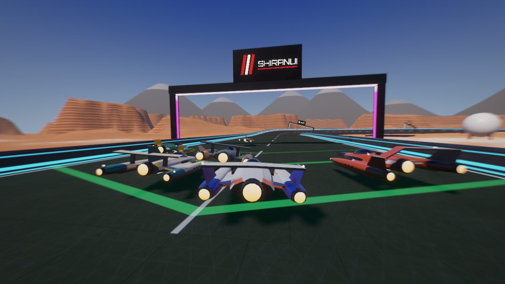
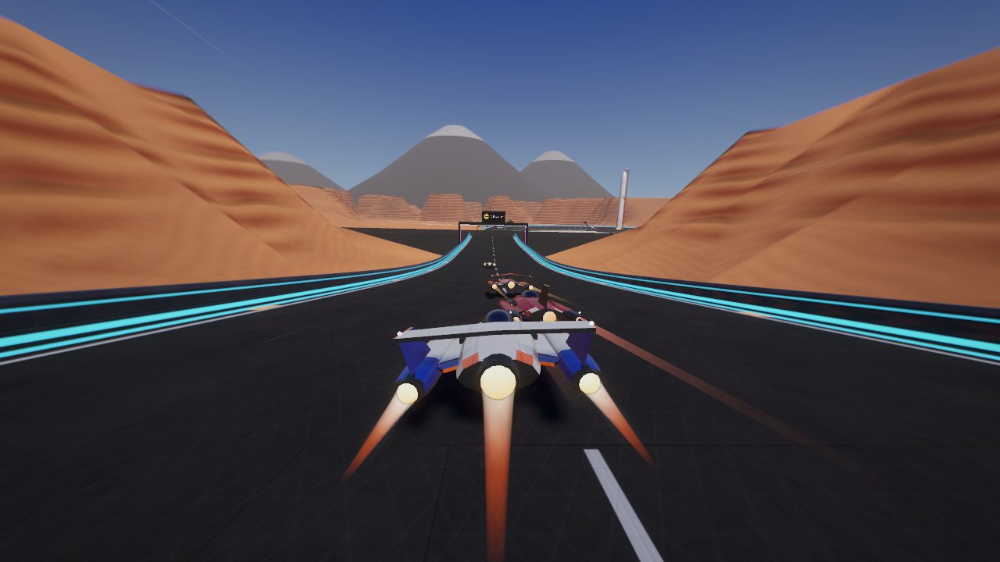
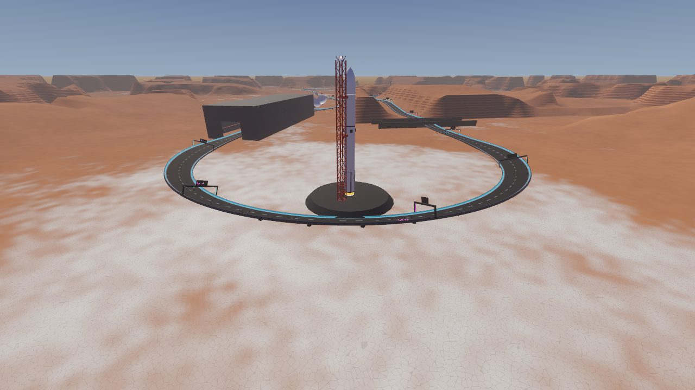
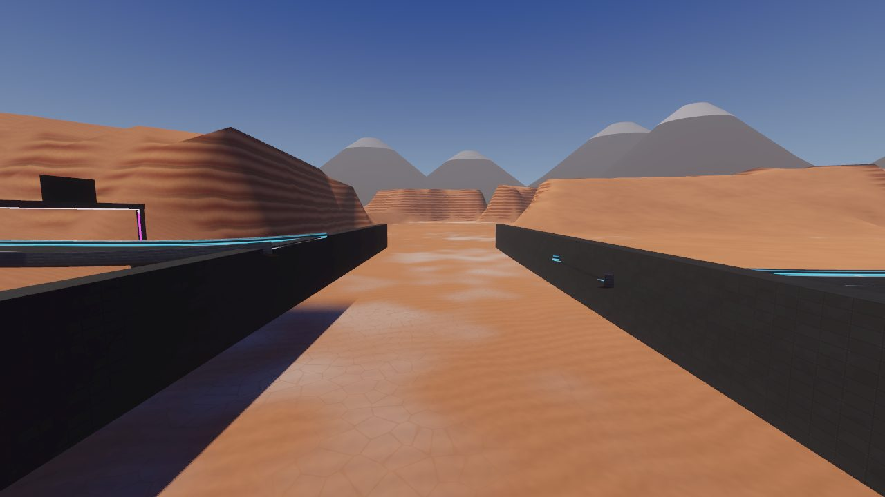
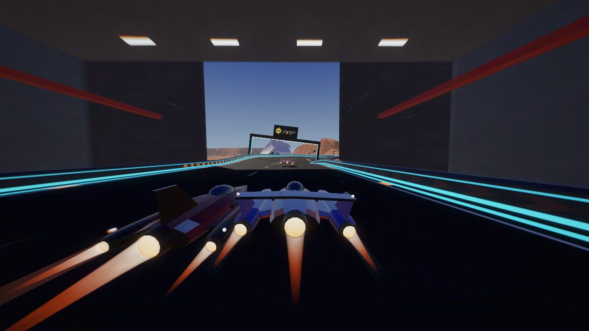
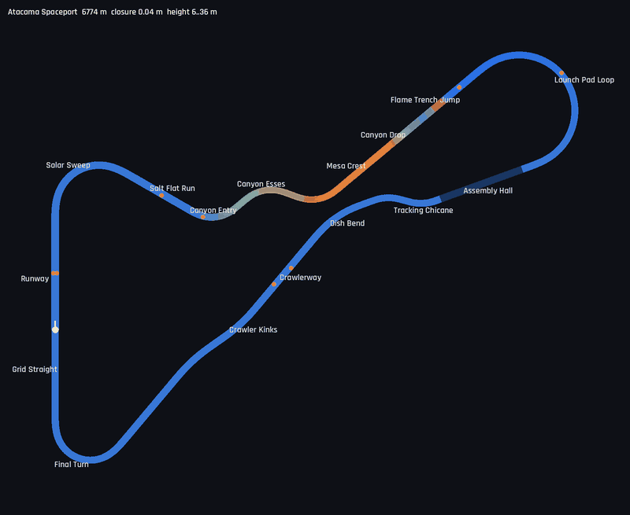

# Atacama Spaceport

6.8 km, clockwise, 6–36 m, a high-desert launch complex in **full daylight**: the only day
circuit, against Helix Bay's dusk city and Glacier Ring's polar night.
Definition: `TrackLibrary._atacama()`. World: `src/world/spaceport.gd`.
Map: `tools/dev.sh map atacama_spaceport /tmp/sp.png`.

## Screenshots

<table>
<tr><td width="50%"> The grid on the runway</td><td width="50%"> Canyon Esses, the rocket on the horizon</td></tr>
<tr><td width="50%"> Launch Pad Loop round the rocket and its tower</td><td width="50%"> Flame Trench Jump: the gap over the trench</td></tr>
<tr><td width="50%"> Through the Assembly Hall</td><td width="50%"> Map (colour = height)</td></tr>
</table>

| Section | Character |
|---------|-----------|
| Runway / Grid Straight | Start on the runway (recharge strip, edge lights, control tower and hangars to the west) |
| Salar Sweep | 120° right over the white salt flats; fuel spheres and solar fields inside |
| Salt Flat Run | Short straight with a boost pad |
| Canyon Entry / Canyon Esses | 70° left, then ±60° esses, climbing 28 m between red-rock canyon walls |
| Mesa Crest / Canyon Drop | Over the crest and down 22 m. The crest speed limit is above ARC pace, so it does not launch |
| Flame Trench Jump | 5.7° kicker, 60 m gap over the launch pad's concrete flame trench: 1.7 s of air at ARC |
| Launch Pad Loop | 200° banked (18°) loop around the 120 m rocket and its launch tower, on a flat salt apron |
| Assembly Hall | 380 m through the vehicle assembly hall: a 30 m-high lit interior with rocket stages in the bays |
| Tracking Chicane / Dish Bend | Between the tracking dishes |
| Crawlerway / Crawler Kinks | Long fast run home past the parked crawler, with a ±15° high-speed S |
| Final Turn | 140° right onto the grid straight |

Measured (ARC, 3 laps, 7 AI): best lap 78.9 s, AI best laps 79.9–84.3 s, longest air 1.67 s,
peak slip 11.7°, lowest hull height 0.96 m. The closest approach between separate parts of the
lap is 282 m (from `test_library_circuits_are_well_formed`).

## Layout method

The first drafts crossed themselves (the crawlerway passed under the canyon, and the hall's exit
cut across the canyon drop). The final layout came from a parameter search: loop length and angle,
canyon entry, dish bend, sweep, salar and salt-flat lengths. It maximises the clearance between
non-adjacent parts of the lap with the two closing straights between 300 and 350 m.

## World

- **Sky and light**: the procedural sky with a high sun (48°), strong directional light with
  shadows, light warm haze.
- **Terrain**: the shared height field and distance field (see `Glacier.distance_field`). There
  are salt flats near the circuit, terraced mesas beyond 220 m, and canyon walls raised outside the
  corridor along the canyon section. A flat apron sits inside the pad loop. The shader adds salt
  polygons, wind ripples and rock strata, all faded with distance.
- **Landmarks**: the rocket (two stages, interstages, grid fins, legs, glowing engine bay,
  venting vapour), a red lattice launch tower with service arms, the flame trench, the assembly
  hall (outer shell, a portal in each end wall, an inner lit shell with lamp rows, catwalks and
  rocket stages), tracking dishes, the control tower, barrel hangars, solar arrays, fuel spheres,
  the crawler, and snow-capped volcanoes on the horizon.
