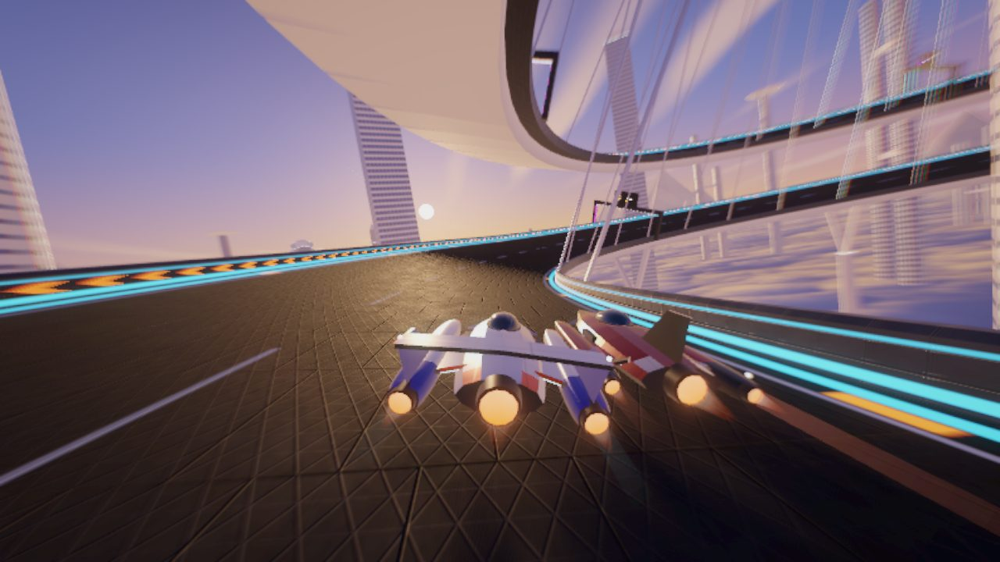
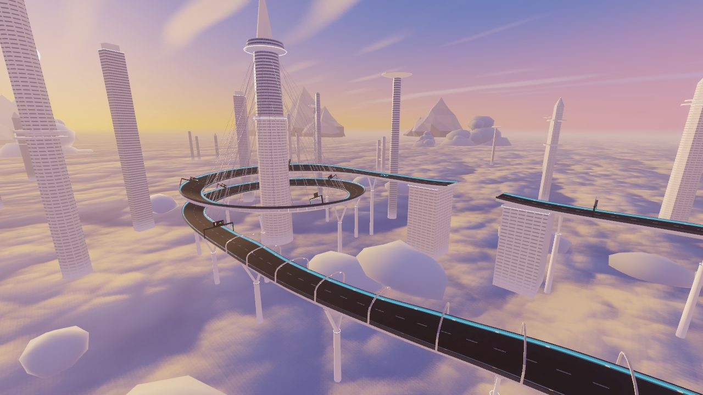
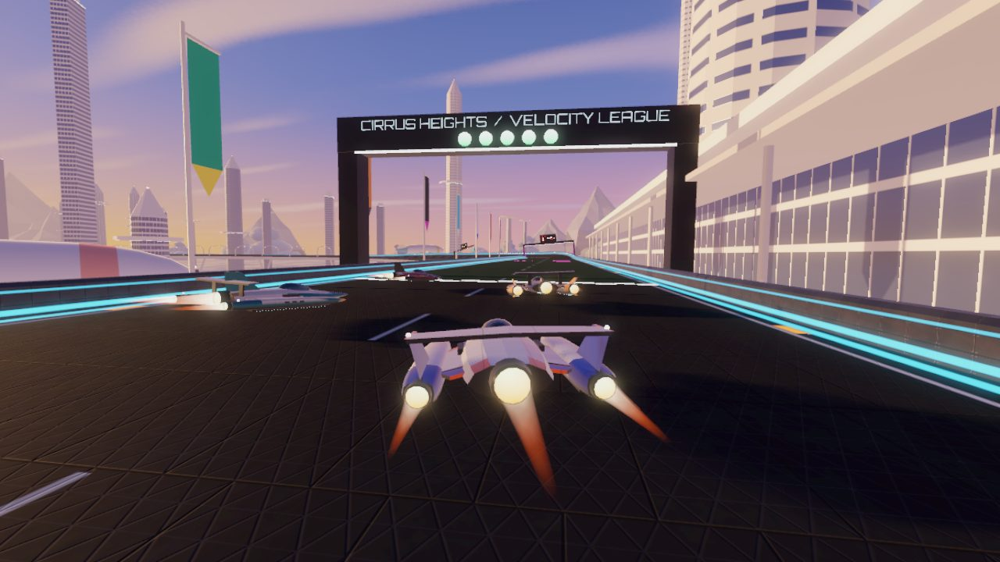
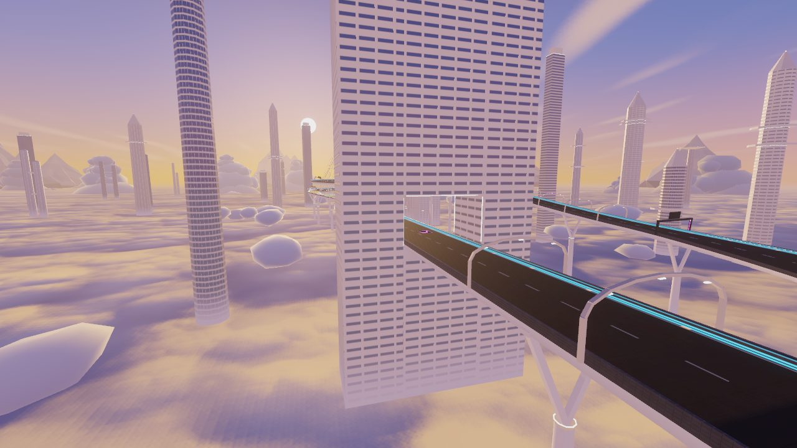
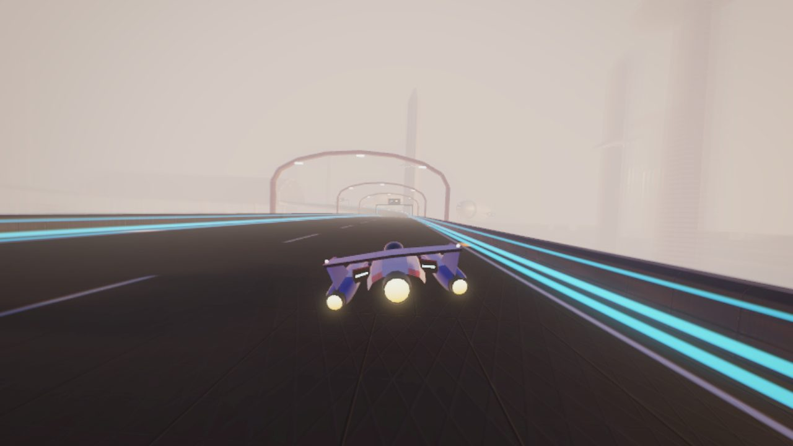
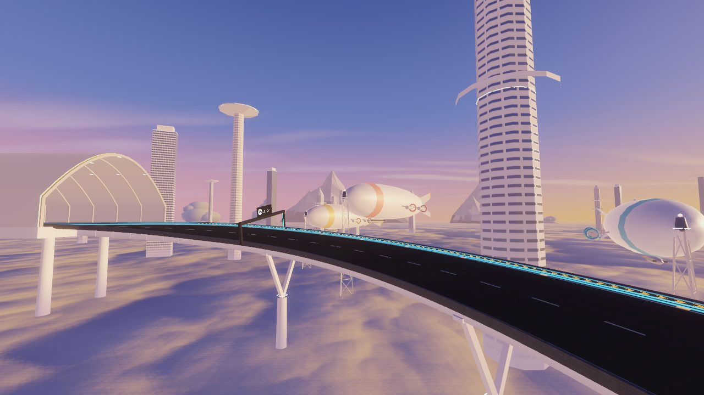
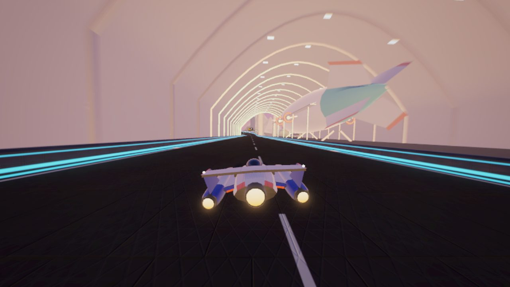
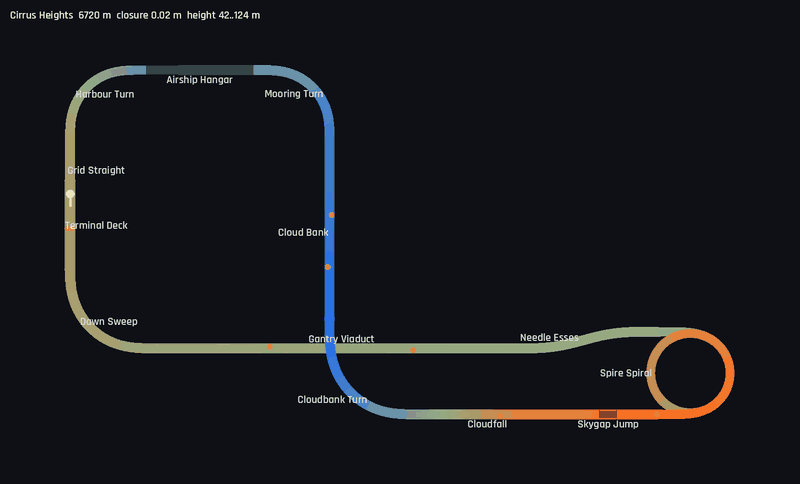

# Cirrus Heights

6.7 km, a **figure-eight**, 42–124 m above a sea of clouds. The sixth world: a sky port at
sunrise, slender white towers rising out of a continuous cloud layer, the low sun painting
everything gold and pink. It follows Helix Bay (dusk city), Glacier Ring (polar night), Atacama
Spaceport (desert day), Lagrange Station (orbit) and Serra Verde (rainforest in rain).
Definition: `TrackLibrary._cirrus_heights()`. World: `src/world/skyport.gd`.
Map: `tools/dev.sh map cirrus_heights /tmp/ch.png`.

## Screenshots

<table>
<tr><td width="50%"> Spire Spiral: the last half-turn overhead, stay cables, the sun on the horizon</td><td width="50%"> The Spire and its spiral above the sea of clouds</td></tr>
<tr><td width="50%"> The grid on the terminal's platform deck</td><td width="50%"> The Gantry Viaduct passing through the Gate Tower</td></tr>
<tr><td width="50%"> Inside the Cloud Bank: fog, lit arches</td><td width="50%"> Airships at their mooring masts beside the Mooring Turn</td></tr>
<tr><td width="50%"> Through the airship hangar, a liner in its cradles</td><td width="50%"> Map (colour = height; the Gantry Viaduct crosses the Cloudbank Turn)</td></tr>
</table>

| Section | Character |
|---------|-----------|
| Grid Straight / Terminal Deck | Start on the terminal's broad platform deck (recharge strip, weapon pads). The terminal hall's glass front and the terminal tower (about 180 m) are on the right, team banners on the left |
| Dawn Sweep | 90° left (min radius 220 m, banked 14°) onto the viaduct |
| Gantry Viaduct | 1.14 km straight east into the rising sun, under white lighting arches every 40 m (boost pad). It passes 40 m over the Cloudbank Turn, then through a portal in the Gate Tower |
| Needle Esses | ±15° kinks (radius 530 m) between needle towers |
| Spire Spiral | One and a half turns (540°) to the right round the Spire, min radius 129 m, banked 20°, climbing 40 m. The deck hangs from a cone of stay cables; the last half-turn passes 25–30 m over the first |
| Skygap Jump | 5.7° kicker on one tower roof, a 60 m gap, landing on the next tower. About 1.65 s of air at ARC |
| Cloudfall | 400 m dive of 36 m under the arches |
| Cloudbank Turn | 90° right (radius 229 m, banked 13°), dropping another 36 m and passing under the Gantry Viaduct |
| Cloud Bank | 550 m inside a mound of cloud. The fog closes in, wisps stream past and the arches glow in the mist (boost pad) |
| Mooring Turn | 90° left (radius 181 m), climbing 20 m out of the bank past airships at their mooring masts |
| Airship Hangar | 340 m through a vaulted hangar, with a liner in its cradles beside the track |
| Harbour Turn | 90° left (radius 181 m), climbing 20 m back to the terminal |

The figure-eight's crossing is the Gantry Viaduct over the end of the Cloudbank Turn, with 40 m of
vertical clearance. The Spire Spiral overlaps itself for half a turn, its centre lines 25–31 m apart
vertically where they are within 35 m horizontally. The closest approach between same-level parts of
the lap is 208 m (`test_library_circuits_are_well_formed`). Closure error is 0.02 m, with the flex
straights at 1137 m (Gantry Viaduct) and 546 m (Cloud Bank).

Measured (ARC, 3 laps, 7 AI, difficulties 1 and 2): player autopilot best lap 80.3 s (difficulty 1)
and 79.6 s (difficulty 2). AI best laps were 81.3–85.2 s at difficulty 1 and 78.6–81.6 s at
difficulty 2. No pilot dropped out; the run ends when the player finishes, so the times of AI
still on their last lap (three at difficulty 1, one at difficulty 2) are projections. For the
player: longest air 1.65 s (Skygap Jump, the only airborne phase longer than 0.3 s), lowest hull
height 0.97 m at the top of the kicker, peak slip 7.8° (Mooring Turn), and no wall contacts above
4 m/s in either race.

## Layout method

Several topologies were tried with a turtle script that mirrors the track builder (scratch files,
not in the repository). A plain loop round the spiral and the jump came out as a 9 km rectangle with
1.2 km straights. A figure-eight with the start straight as the crossing needed a 1.8 km start
straight. What worked was a figure-eight whose eastern lobe is a hook. The Gantry Viaduct runs east
into the Spire Spiral, which turns through 540° and sends the lap back west, parallel to the viaduct
and about 210 m south of it, for the jump and the Cloudfall. The Cloudbank Turn then swings north
under the viaduct, and the western lobe (Mooring Turn, hangar, Harbour Turn, terminal, Dawn Sweep)
is a square of three left turns. Total turning is 360° (630° right in the hook, 270° left in the square).

The flex straights are the Gantry Viaduct (east) and the Cloud Bank (north), which are perpendicular,
so the closure is well conditioned. A random search over the corner and straight lengths kept
candidates of 6.2–6.9 km with at least 60 m between same-level parts. The Needle Esses were added to
the long viaduct afterwards: their net heading change is zero, so they only shift the flex lengths.
The descent from the spiral top to the cloud bank is split between the Cloudfall and the following
turn and chained with `exit_slope`, so the dive never steepens into a corner. The first AI races
on this layout ran without changes: no wall contacts, peak slip under 8°.

## World

- **Sky and light** (`sky_dawn.gdshader`, `skyport_sky.gdshaderinc`): a gradient from deep blue
  overhead through lavender to rose and gold at the horizon. Opposite the sun there is a pink belt
  above a blue-grey shadow band. The sun is a disc with glow, 9° up due east, so the Gantry Viaduct
  races straight into it. High cirrus come from one baked texture projected on a plane. There is no
  TIME and no per-pixel noise, so the radiance cubemap renders once. The sun light is warm (1.0, 0.77,
  0.55), ambient and reflections come from the sky, and a thin exponential fog uses aerial
  perspective, so far objects take on the sky colour.
- **Sea of clouds** (`cloud_sea.gdshader`): one 17.6 km plane at y = 10 m that follows the camera.
  The cloud tops come from a baked tileable texture, `skyport_clouds.png`, made by
  `tools/gen_skyport_textures.py`. Its puffs are a soft maximum of rounded caps at three scales with
  a gentle domain warp, so they have cauliflower outlines. Its lighting is baked: diffuse from the
  low sun plus soft shadows ray-marched across the height field towards the sun (R), with height (G)
  and an ambient term for the folds (B). The shader fetches it three times at different scales and
  rotations. It maps the light between lavender shadow and peach-gold, adds a forward-scatter glow
  towards the sun, and fades into exactly the sky shader's below-horizon colour with distance, so the
  plane's edge never shows. It is unshaded and handles its own haze (scene fog is off for it). The
  sun constants are shared with the generator and must match.
- **Clouds as meshes** (`cloud_puff.gdshader`): cumulus heads and their satellite puffs stand
  1–6.5 km out, and small puffs drift below the decks. They are lumpy low-poly blobs lit in the
  shader with wrapped diffuse, a pink base and a silver lining when seen against the sun.
- **Towers** (`skyport_tower.gdshader`): about 80 towers on High (100 on Ultra, scaled by the `city`
  preset factor), kept at least 48 m from the centre line. There are four kinds: needles with
  platform discs, glass slabs, twin shafts with sky bridges, and pad towers with landing discs. The
  stone is warm white. The glass is a smooth blue-grey half mirror that reflects the sky, in ribbon
  windows broken by stone piers or as curtain walls. Every tower and pier fades into mist over its
  last 30 m above the cloud tops, which hides where it meets the cloud plane.
- **Viaducts**: a white box girder under every open stretch of deck, and V piers every ~105 m that
  drop into the clouds. Piers are left out wherever another part of the track runs below (the spiral
  overlap, the crossing). Lighting arches every 40 m line the Gantry Viaduct, the Cloudfall and the
  Cloud Bank, with shadows, and the shared light gates with team boards stand elsewhere.
- **Landmarks**: the terminal, with the platform deck on piers, the glass hall and canopy, the tower
  with its control cab and team banners. The Gate Tower, which the viaduct passes through. The Spire
  (about 380 m above the cloud tops), with a lit halo ring and a cone of stay cables to the inner edge of the spiral (cables
  that would pierce the other ramp are left out). The two tower roofs of the Skygap Jump. The hangar:
  a vaulted shed on piers with lit ribs and amber portals, a floor beside the track, cradles and a
  gantry walkway.
- **Airships**: an original design, the "Cirrus" liner. It has a slim teardrop hull lathed in
  sections (a coral band behind the nose, a teal tail), four fins in an X, a glazed gondola and
  four ducted engines on outriggers. Seven ride at lattice mooring masts, noses into the wind: three
  by the Mooring Turn, two near the terminal and two elsewhere. One sits in the hangar and two cruise
  slowly on wide circles far out.
- **Cloud Bank**: a chain of large flattened blobs with cauliflower heads around the Cloud Bank
  section. A `FogBank` node measures how deep the camera is inside them. As it goes in, it raises the
  fog density (0.00016 to 0.0034), turns off aerial perspective so the fog is a flat warm white,
  fogs the sky and the cloud sea, starts the wisp particles (soft billboards around the camera,
  scaled by the `particles` preset factor) and screen-door dissolves the bank meshes so their inner
  surfaces never show as walls.
- **Far scenery**: eleven snowy massifs (a summit with two or three shoulders, faceted, with spurs)
  5.4–7.8 km out, piercing the clouds and lit pink-gold from the east.

## Performance (desktop)

Windowed lap, autopilot, 5 AI, Intel Arc, auto preset (Ultra on desktop; the phone runs High):
median 108 draw calls (max 203), median 160k primitives, 90th percentile about 320k, max 370k.
The peaks come from the track mesh itself. From the top of the spiral and the start of the Cloudfall,
almost the whole lap is in view and nothing in the open sky occludes it: with every world part
skipped (`--skyport-skip=...`) those frames still reach 255–263k. World build 0.85–1.7 s windowed (3.3 s once while the machine was heavily loaded by other jobs),
0.5 s headless. The cloud sea is three texture fetches per pixel, and the sky is a gradient and one
fetch. Galaxy A56 (High, 2 laps): 59.7 / 59.9 fps mean (lap 1 / lap 2), lowest 1 s sample 48 / 55,
primitives median about 178k, max 380k; world build 1.4 s (see `docs/PERFORMANCE.md`).

## Development aids added

- `tools/gen_skyport_textures.py`: the cloud sea and cirrus textures (numpy and Pillow,
  deterministic). Both import with mipmaps and VRAM compression.
- `--skyport-skip=supports,terminal,gate_tower,spire,jump_towers,hangar,cloud_bank,gantries,gates,masts,towers,far,cruisers`
  leaves those parts of the world out, to measure what each costs (`--telemetry`).
- `--load-times` also prints the number of towers and moored airships placed.
