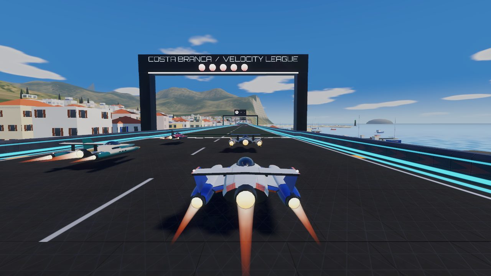
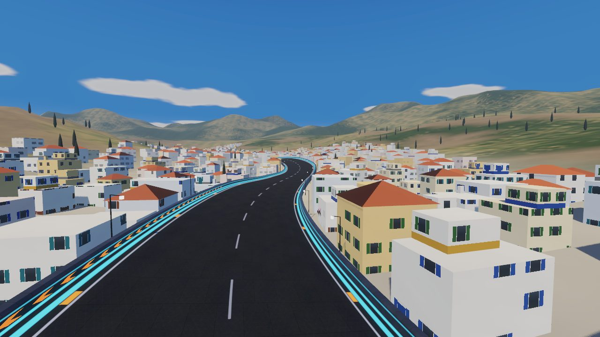
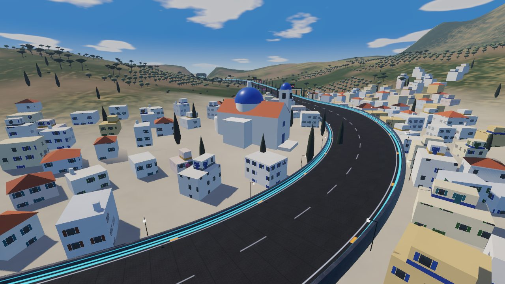
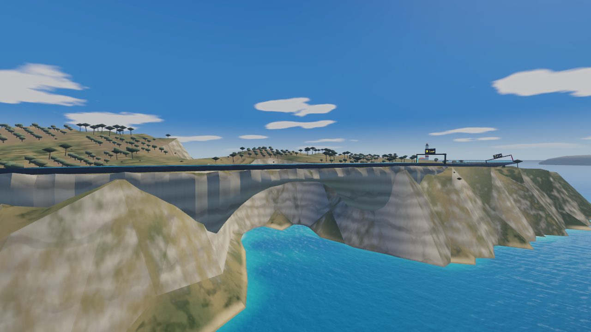
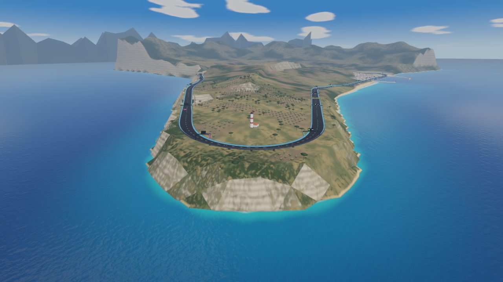
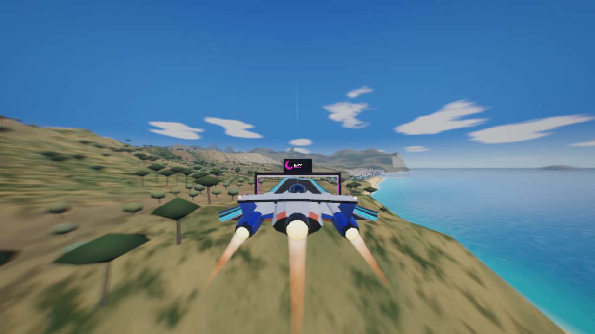
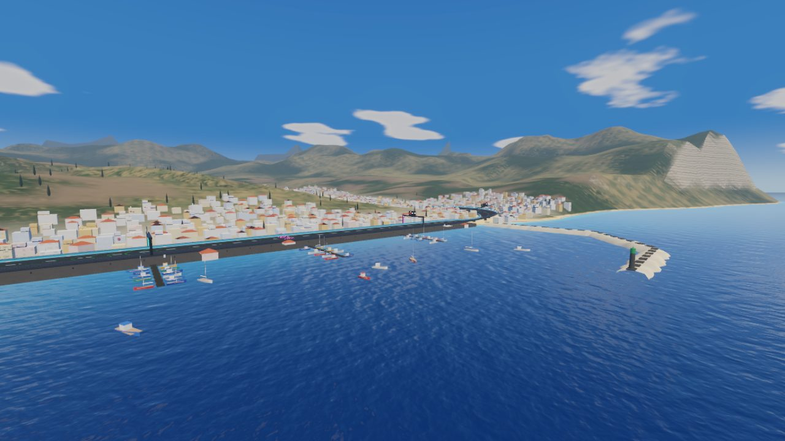
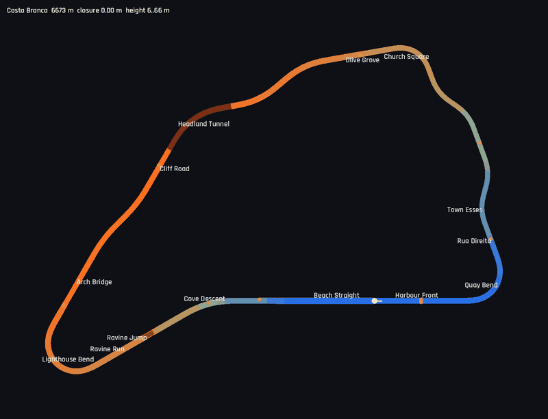

# Costa Branca

6.7 km, anticlockwise, 6–66 m. The sixth world: a whitewashed Mediterranean town above its
harbour on a bright summer afternoon, with limestone sea cliffs, a lighthouse on the headland and a
sandy cove. It is the only sunny seaside circuit: Helix Bay is a city at dusk, Glacier Ring polar
night, Atacama Spaceport a desert, Lagrange Station orbit, Serra Verde a rainforest in the rain.
Definition: `TrackLibrary._costa_branca()`. World: `src/world/coastal.gd`.
Map: `tools/dev.sh map costa_branca /tmp/cb.png`.

## Screenshots

<table>
<tr><td width="50%"> The grid on the Harbour Front: the town to the left, the harbour to the right</td><td width="50%"> Climbing through the town between the house walls</td></tr>
<tr><td width="50%"> Church Square: the domed church at the top of the town</td><td width="50%"> The Arch Bridge: a natural limestone arch over a sea inlet</td></tr>
<tr><td width="50%"> The headland: the Lighthouse Bend wraps round the lighthouse</td><td width="50%"> Ravine Jump: in the air over the gully, the cove and the town ahead</td></tr>
<tr><td width="50%"> The harbour and the town from the sea</td><td width="50%"> Map (colour = height)</td></tr>
</table>

| Section | Character |
|---------|-----------|
| Harbour Front | Start on the quay (recharge strip, weapon pads). Houses line the left side; on the right the quay, four jetties with fishing and sailing boats, and the basin closed by two moles with red and green beacons |
| Quay Bend | 110° left, banked 14° (radius 157 m), into the town, narrowing to 27 m |
| Rua Direita / Town Esses | The climb through the town, 25 m wide between house walls: a straight ramp (boost pad), then ±35° esses that alternate ramps and level terraces, 10 → 48 m |
| Church Square | 80° left at the top of the town, round the domed church with its bell tower and cypresses |
| Olive Grove | Climbing to 62 m through the olive groves: a cypress avenue, then a ±30° S |
| Headland Tunnel | 420 m, 50° left (radius 336 m), under a spur of the hill. Masonry portals, a lamp strip along the crown |
| Cliff Road | On the cliff top 66 m above the sea (boost pad), with a ±15° kink following the coast |
| Arch Bridge | 240 m, the middle of it on a natural limestone arch over a sea inlet |
| Lighthouse Bend | 150° left round the lighthouse at the tip of the headland, banked 16° (radius 154 m), descending 8 m |
| Ravine Run / Ravine Jump | A 140 m run-up, then a 5.7° kicker and a 60 m gap over a dry ravine that opens to the sea: about 1.65 s of air at ARC |
| Cove Descent | 30° right, then straight, dropping 40 m in 660 m to the beach |
| Beach Straight | 400 m along the sand (boost pad), straight into the Harbour Front: about 1 km flat out to the Quay Bend |

The sea is always on the right of the lap and the land on the left. The closest approach between
same-level parts of the lap is 296 m (`test_library_circuits_are_well_formed`). Closure error
0.00 m; flex straights 129 m (Rua Direita) and 400 m (Beach Straight).

Measured (ARC, 3 laps, 7 AI, time scale 4): player autopilot best lap 77.2 s (difficulty 1) and
77.8 s (difficulty 2); AI best laps 77.6–82.7 s at difficulty 1 and 76.1–79.0 s at difficulty 2.
Longest air 1.65 s, lowest hull height 0.97 m, peak slip 12.9° (difficulty 1, Quay Bend). Player
wall contacts above 4 m/s: none at either difficulty (one 0.2 m/s brush in the Town Esses at
difficulty 2). At difficulty 1 the player wins and the race ends before the AI finish, so their
total times are estimates; every AI ship completed its laps.

## Layout method

A turtle script mirroring the track builder (Hermite heights, eased turns) laid out an
anticlockwise loop: up through the town, west along the ridge, through the headland, south along
the cliffs, round the tip and back east along the shore. The first drafts were boxes about
3 × 1.3 km with a 2.2 km straight along the ridge. A parameter search over the Quay Bend angle,
the Church Square and tunnel turns, the Lighthouse Bend angle and the descent produced the
final shape: the headland points south-west and the Lighthouse Bend turns 150° round its tip. The
flex straights are the Rua Direita (heading about 330°) and the Beach Straight (90°), 120° apart,
so the closure is well conditioned.

The first AI race found one fault. The kicker came straight out of the Lighthouse Bend; the
autopilot was still crossing from the inside of the bend at about 10 m/s, kept drifting in the
air and touched the right-hand wall at 10 m/s after landing. A 140 m straight run-up (the Ravine
Run) before the kicker fixed it.

## World

- **Sky and light**: `sky_coastal.gdshader`, a deep blue sky with a hazy horizon, the sun and
  its glare, and a few fair-weather cumulus sampled from a baked texture
  (`assets/textures/coastal_clouds.png`, from `tools/gen_coastal_textures.py`). It does not use
  TIME, so the radiance map is rendered once. The sun stands 50° high in the south-south-west, so
  the town's south-facing fronts are lit from the sea, and there is a light haze.
- **Coastline**: a polyline built from offsets to the right of the coastal sections (Cliff Road
  to Harbour Front), extended north along the open coast and east past the harbour. Each point
  carries a land slope and a sea-floor slope (cliff, rocky shore, beach, quay). A signed distance
  to it (the same two-pass propagation as `Glacier.distance_field`) caps the terrain: cliffs drop
  60 m to the water, the beach shelves gently, the harbour basin is 5.5 m deep. Under the Arch
  Bridge the line swings in under the track to make the inlet.
- **Terrain**: the shared height field. Hills rise away from the circuit and mountains inland; a
  spur stands over the Headland Tunnel and a knoll under the lighthouse. Near the track the ground
  is cut and filled to just under the deck, except over the inlet and the ravine. The target is
  the lowest point of the deck underside: in banked corners the inner edge is several metres below
  the centre line, and the first version had the ground showing through the track there. The
  ravine is carved along a polyline down to the sea. Cells entirely under water are skipped
  (about 20k triangles remain). `coastal_ground.gdshader` draws dry grass, scrub, red soil under
  the olive groves, paving in the town, sand at the waterline, and pale limestone with strata on
  steep faces. Steepness is taken from the facet (screen-space derivatives) as well as the vertex
  normal, so the cliffs read as rock on the 32 m grid. Variation comes from a baked noise texture.
- **Sea**: one opaque surface (a grid over the height field plus a skirt to the horizon) with
  `sea.gdshader`. Its depth comes from an R8 texture made from the height field at load time, so
  it shades from sand-coloured shallows through turquoise to deep blue and adds foam at the shore
  without reading the depth buffer. Ripples are a baked normal map sampled twice. The sea does not
  receive shadows (`shadows_disabled`): with shadow sampling over half the screen, the cliff and
  headland views ran at 38–48 fps on the desktop; without it they stay at 55–60.
- **Town**: about 1,660 houses (Ultra preset) merged into one mesh per 400 m cell, with a
  visibility range. A row of houses lines both sides of the track through the town; the rest
  stand on jittered lots up the hill, turned along the contour so they step up the slope, and
  reach down to the ground on their downhill side. Houses get flat roofs (some with a set-back
  upper storey or a chimney), terracotta hip roofs, or a splash of bougainvillea.
  `facade_day.gdshader` draws windows, shutters, doors and a painted plinth per floor and bay from
  a per-house seed: no geometry, faded to the average colour with distance.
- **Landmarks**: the domed church on Church Square; the harbour (quay wall and apron, bollards,
  jetties on piles, about 50 boats, rubble moles with beacons); the Headland Tunnel (lofted lining
  and lamps, a rock hump over it that sinks into the hillside, masonry headwalls with a voussoir
  ring); the natural arch; the lighthouse with its keeper's house; parasols, loungers, beached
  boats and a kiosk on the beach; offshore islets and inland mountains beyond the height field.
- **Vegetation**: olive groves in rows, cypresses (an avenue along the Olive Grove, a ring round
  the church), umbrella pines clumped on the headland, and scrub, about 6,100 instances at Ultra in
  400 m MultiMesh cells with visibility ranges. Density scales with the preset (`city` factor).

## Notes

- **Vertex colours are linear** in a StandardMaterial3D unless `vertex_color_is_srgb` is set.
  Colours picked as sRGB came out pale and grey (the olive trees looked like snowballs). The local
  materials in `coastal.gd` set the flag, and the facade shader squares its tint.
- **Seabed smoothing**: the sea floor is box-blurred away from the shore so the depth does not
  jump where the nearest stretch of coast changes from cliff to beach. Cliff heights must be
  clamped before blurring, or they lift the sea floor in front of them into shallow patches.
- **Performance** (desktop, Intel Arc iGPU, Ultra preset because autopilot runs use the auto
  preset, 1280 × 720, one lap with five AI and the HUD): median 142 draw calls (max 196), median
  181k primitives (max 379k, looking across the bay at the town from the Ravine Run), 60 fps
  median, 49 fps minimum on the grid. Not yet measured on the A56; the High preset has lower
  densities and view ranges than Ultra. The world builds in about 2.1–2.5 s on the desktop
  (terrain about 0.8 s, town 0.6 s).
- `--dump-terrain=out.png` writes a plan of the height field with 20 m contours, the track, the
  coastline, the ravine and the landmarks. `--load-times` also prints the house and tree counts,
  the build time per step and a triangle count per kind of node.
