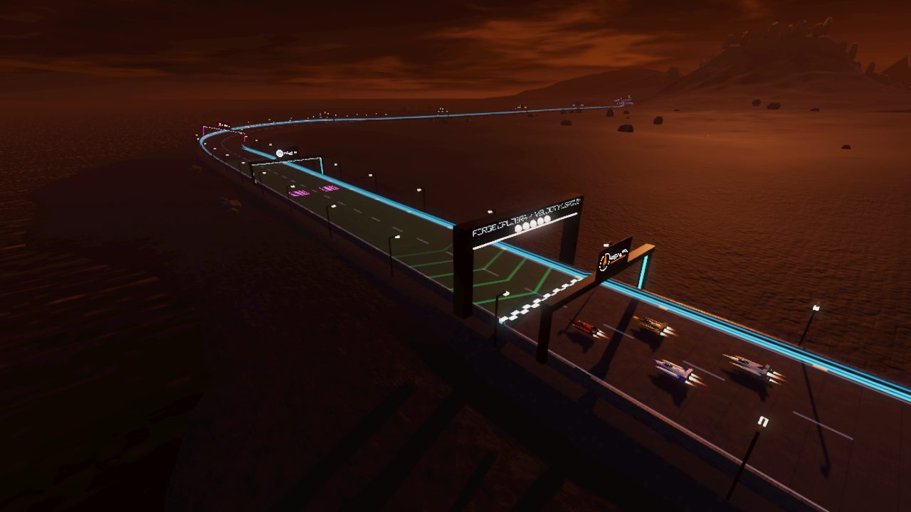
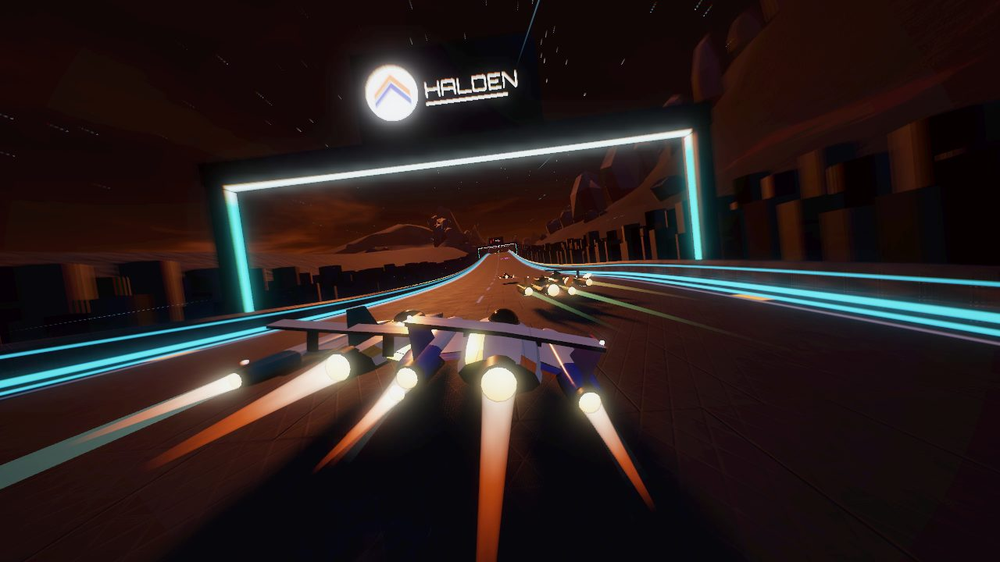
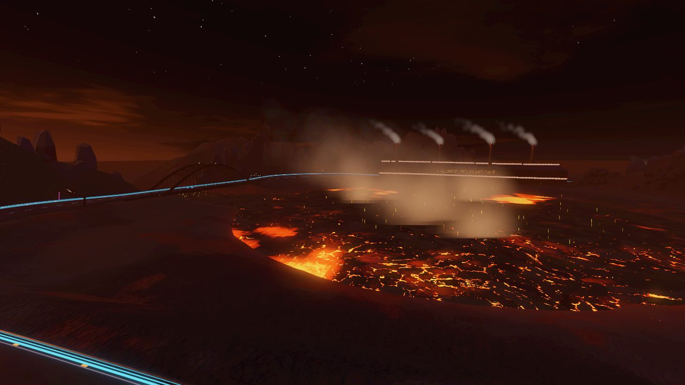
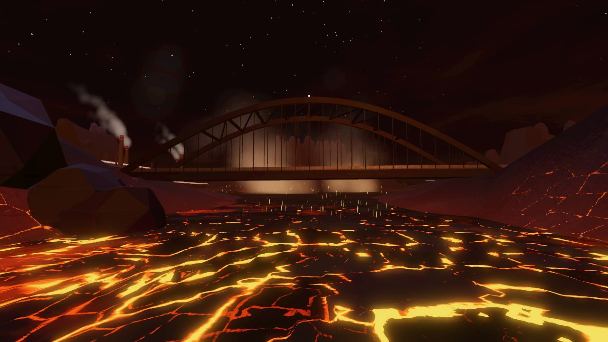
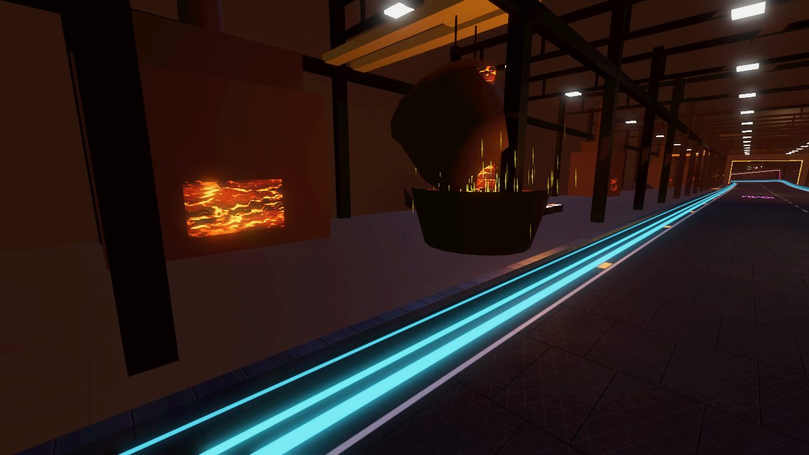
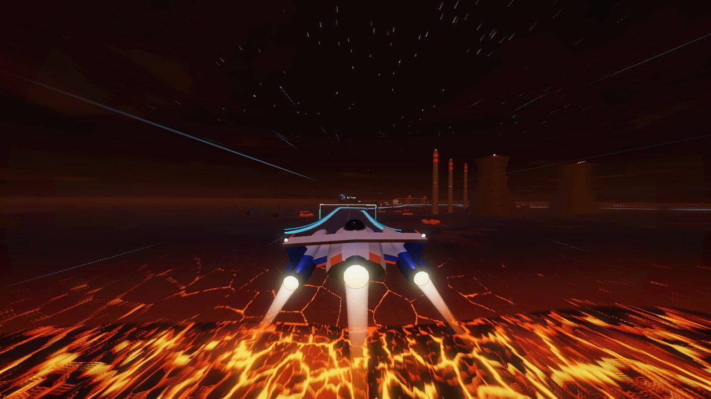
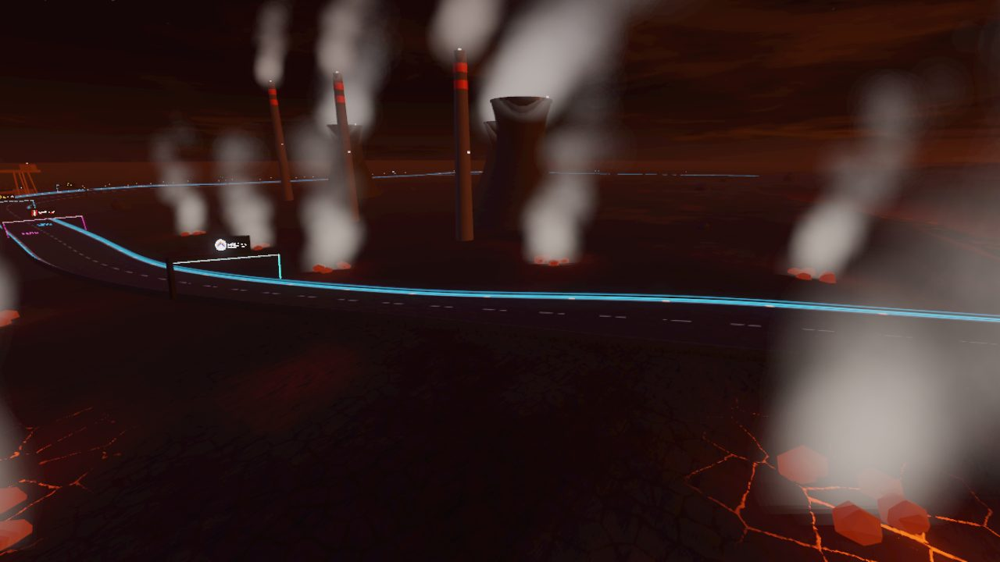
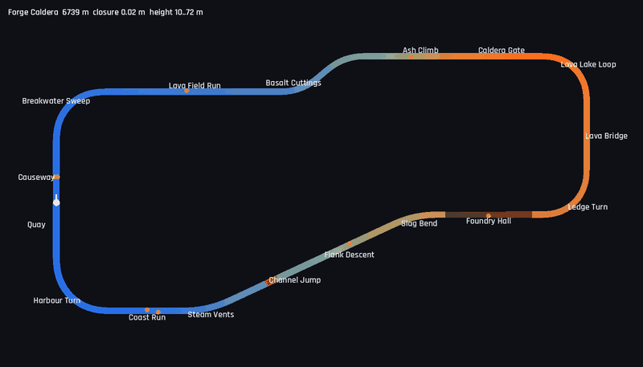

# Forge Caldera

6.7 km, clockwise, 10–72 m. A volcanic island **at night**, with a foundry built into a live
caldera: the lava is the main light source, low ash clouds glow orange from below, and the dark
sea lies off the west and south coasts. No rain. It follows Helix Bay (dusk city), Glacier Ring
(polar night), Atacama Spaceport (desert day), Lagrange Station (orbit) and Serra Verde
(rainforest). Definition: `TrackLibrary._forge_caldera()`. World: `src/world/forge.gd`.
Map: `tools/dev.sh map forge_caldera /tmp/fc.png`.

## Screenshots

<table>
<tr><td width="50%"> The grid on the causeway, the sea to the left, the volcano ahead</td><td width="50%"> Basalt Cuttings: walls of hexagonal columns</td></tr>
<tr><td width="50%"> The lava lake inside the caldera, Foundry Hall and the Lava Bridge beyond</td><td width="50%"> The Lava Bridge over the lake's outflow</td></tr>
<tr><td width="50%"> Foundry Hall: a crucible pouring into a ladle, a furnace mouth</td><td width="50%"> Channel Jump: in the air over the lava channel</td></tr>
<tr><td width="50%"> Steam Vents, with cooling towers and stacks inside the turn</td><td width="50%"> Map (colour = height; red = the jump gap; dark = Foundry Hall)</td></tr>
</table>

| Section | Character |
|---------|-----------|
| Quay / Causeway | Start on a causeway of basalt blocks along the west coast (recharge strip, weapon pads, 32 m wide). The sea laps the boulders to the left; to the right lies a field of black, cooled lava. Sodium lamps on both edges |
| Breakwater Sweep | 90° right, banked 12°, round the north-west corner of the bay |
| Lava Field Run | 764 m straight across the lava field (flex straight, boost pad), the volcano ahead |
| Basalt Cuttings | ±40° esses climbing 16 m between walls of hexagonal basalt columns, 28 m wide |
| Ash Climb | 480 m climbing 30 m up the flank, still between column walls (weapon pad) |
| Caldera Gate | Through a saddle in the rim, still between column walls, to the highest point of the lap (72 m) |
| Lava Lake Loop | 90° right, banked 14°, on a ledge inside the caldera. The lava lake lies 18–28 m below, to the right |
| Lava Bridge | 240 m on a steel through-arch over the lake's outflow arm, about 20 m above the lava (boost pad) |
| Ledge Turn | 90° right on the ledge, the rim wall rising 80–100 m above the track to the left |
| Foundry Hall | 420 m tunnel through the smelter built against the rim (28 m wide, 20 m ceiling): crucibles hang from bridge cranes and pour into ladles in the side bays, furnaces glow along the walls |
| Slag Bend | 25° left out through the rim saddle, under a conveyor gantry |
| Flank Descent | 480 m descending 16 m down the south-west flank, under a second conveyor |
| Channel Jump | 5.7° kicker and a 60 m gap over a glowing lava channel that runs from a vent inside the circuit down to the sea. About 1.65 s of air at ARC |
| Steam Vents | 25° right between fumaroles; cooling towers and stacks stand inside the turn |
| Coast Run | 260 m along the south coast (boost pad) |
| Harbour Turn | 90° right past the ore harbour: a quay, two gantry cranes and a moored ore carrier |

There are no crossings: the lap is a clockwise loop round the volcano's west flank, with the
caldera at its east end. The closest approach between parts of the lap more than 400 m apart is
345 m (s=2816/3216, the two legs of the U round the lake; `test_library_circuits_are_well_formed`).
Closure error 0.02 m; flex straights 764 m (Lava Field Run) and 212 m (Quay). The tightest corner
is the Lava Lake Loop at a 196 m minimum radius.

Measured (ARC, 3 laps, 7 AI, difficulties 1 and 2, headless at 4× time scale): player autopilot
best lap 75.7–75.8 s, AI best laps 74.4–80.6 s, 1.65–1.68 s of air at the Channel Jump every lap,
lowest hull height 0.98 m, peak slip 8.6° (difficulty 2, Lava Lake Loop) and 12.4° (difficulty 1,
on the Ash Climb straight). Wall contacts above 4 m/s: none at either difficulty; the only contact
was a 3.5 m/s touch just after the landing at difficulty 1. At difficulty 1, three AI had finished
when the session closed after the player; the other five were on their last lap (projected
3:58.9–4:05.5).

Windowed on the desktop (Intel Arc, auto preset Ultra, one lap with five AI): draw calls median 137,
max 210; primitives median 140k, max 277k. The peaks are the views across the open island: east
along the north leg toward the volcano, and west out of Foundry Hall. Not yet measured on the phone.

## Layout method

The sketch was a rounded rectangle round the volcano: the coast on the west side (the causeway),
the climb along the north side, the caldera at the east end, the descent along the south. A
turtle script mirroring the track builder placed the segments; the Lava Field Run (heading east)
and the Quay (heading north) are the flex straights, so they are perpendicular and the closure is
well conditioned. The caldera part is a U of two 90° corners and a straight (the bridge), so the
lake can sit inside it with the track on a ledge about 384 m from its centre. The start line was
then moved 150 m up the west straight, so the straight before it is 212 m long for the grid.

The world derives everything from the finished track, not from fixed coordinates: the caldera
centre is the bridge's midpoint moved inward by half the distance between the U's two legs. The
rim follows the U about 100 m outside it and closes across its mouth; where the track crosses the
rim (the Ash Climb and Foundry Hall) the crest drops to a saddle. So the layout can still be tuned
without the scenery falling apart.

## World

- **Sky and light**: `sky_forge.gdshader` draws a near-black sky, a warm haze on the horizon and
  low ash clouds from a baked cloud texture (two lookups, no per-pixel noise, no `TIME`, so the
  radiance map renders once). The clouds' underside glows orange, strongest toward the caldera.
  The scene's directional light is the lava glow: orange, low (18°) and coming from the caldera
  side. A dim blue moon fills from above, the ambient light is a warm grey, and the fog is a dark
  orange haze. Eleven omni lights put the lava's light on the track, ships and buildings: three at
  the lake's edge, one under the bridge, five in Foundry Hall and two where lava meets the sea. They
  skip the terrain's visual layer, because its glow is baked.
- **Terrain**: the shared height field and track distance field (`Glacier.HF`,
  `Glacier.distance_field`), plus polyline fields (`Rainforest._poly_field`) for the two lava
  rivers. A cone with radial gullies rises to a rim of about 225 m (±45 m), with saddles at
  112 m and 104 m where the track crosses it and a breach in the east where the outflow leaves.
  Inside lie the caldera floor (51 m) and the lake bowl. Near the track the ground follows the deck
  with a per-section offset: a cutting (+12 to +14 m) on the climb, embankments elsewhere, a ledge
  in the caldera. The coastline is star-shaped round the circuit's middle, 60–700 m off the coastal
  sections and far beyond the volcano. An extinct cone to the north-east fills the skyline. The
  terrain is built in tiles of about 1 km so it can be frustum-culled, and tiles wholly under
  the sea are left out.
- **Heat**: the terrain's vertex colour carries a heat value, which is high near the lake, the
  lava rivers, the fumaroles and in scattered patches on the caldera floor. `volcanic.gdshader`
  turns it into glowing cracks at two scales (only part of the cell net glows, so the cracks
  wander) and a dull red bloom. It also draws black lava low down, ash and rust-red scoria on
  the flanks, columnar joints on steep faces, black sand at the waterline and a cheap bump
  from the noise texture. All its noise comes from `forge_noise.png` (tileable fbm, Voronoi edges
  and cell ids, baked by `tools/gen_forge_textures.py`).
- **Lava**: `lava.gdshader` (unshaded) draws crust plates drifting over the melt, with bright
  seams and upwellings. Two cell scales and a domain warp keep the net from reading as a tiling.
  The lake is a disk plus the outflow arm at 44 m, seen where the ground is carved below it. The
  outflow below the breach and the jump's channel are ribbons draped on their carved beds that
  stream along their length and stop at the sea.
- **Structures**: the causeway embankment with boulders and lamps; about 1,800 instanced basalt
  columns in two stepped rows along the cuttings; jagged crags along the rim crest, on the inner
  wall and over the flanks; the through-arch Lava Bridge (two steel ribs, hangers, bracing,
  abutments). Foundry Hall is lofted along the track: inner walls, side floors, trusses, crane
  rails, lamps, eight furnaces, three crucible pours with sparks and ingot moulds, a clad exterior
  with a gable roof, lit window bands and four chimneys. Outside are three cooling towers, three
  stacks, two conveyor gantries over the descent, nine fumaroles and the ore harbour.
- **Particles**: smoke and embers over the lake, sparks at the pours and under the bridge, smoke
  from the chimneys and stacks, steam from the towers and the fumaroles, and steam where lava
  meets the sea. Counts scale with the preset's `particles` factor; the scattered crags scale with `city`.

## Notes

- **Particles at the origin.** The first build's preprocessed smoke and embers all appeared in
  one cloud at the start line, the world origin. The emitters were static `GPUParticles3D` in
  world coordinates; the likely cause is that their preprocess ran before the emitter's transform
  reached the renderer. All emitters here now use `local_coords = true`, which fixed it. Two more surprises from
  the same test plume: after `add_point`, `set_color(get_point_count() - 1)` did not recolour the
  end of the ramp (the old particles stayed white), so the ramps are now set from `offsets` and
  `colors` arrays; and a 1 m quad with `scale_min/max` of 4–8 (and a scale curve) drew particles of
  only about 1–2 m, so the size is now set on the `QuadMesh` (as `Rainforest._spray` does), with
  the scale range as a fraction.
- **An open island shows most of the lap at once.** The shared track mesh is about 280k
  triangles, and from the west side most of it is in view. `Forge._track_range` gives the
  track's chunk meshes a visibility range of 1450 m × the preset's view factor (the exponential fog,
  density 0.0011, is about 80% there). TrackMesh itself is unchanged.
- The lava lake was first a square plane round the caldera. It floated above the low end of the
  Ash Climb, which runs inside that square below lava level. It is now a disk plus the arm.
- `--dump-terrain=out.png` writes a plan of the heights, sea, lava, heat and rivers with
  cross-sections per section, and `--mesh-stats` prints triangles per world node group.
