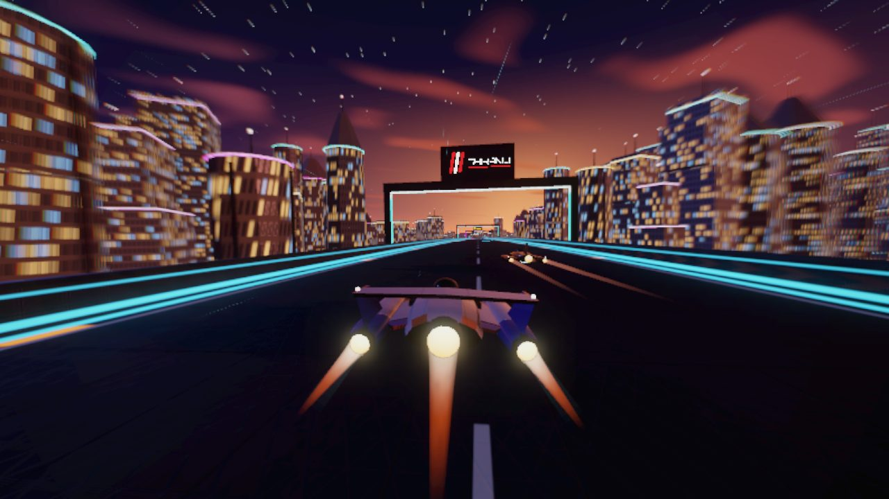
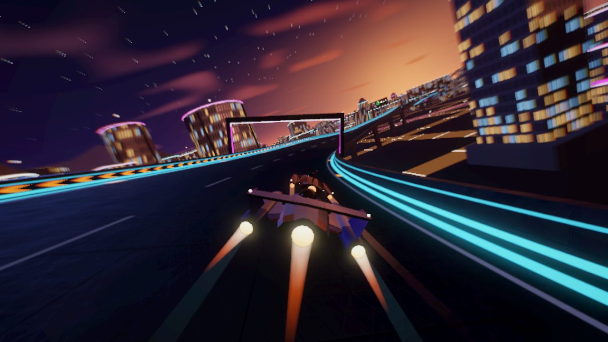
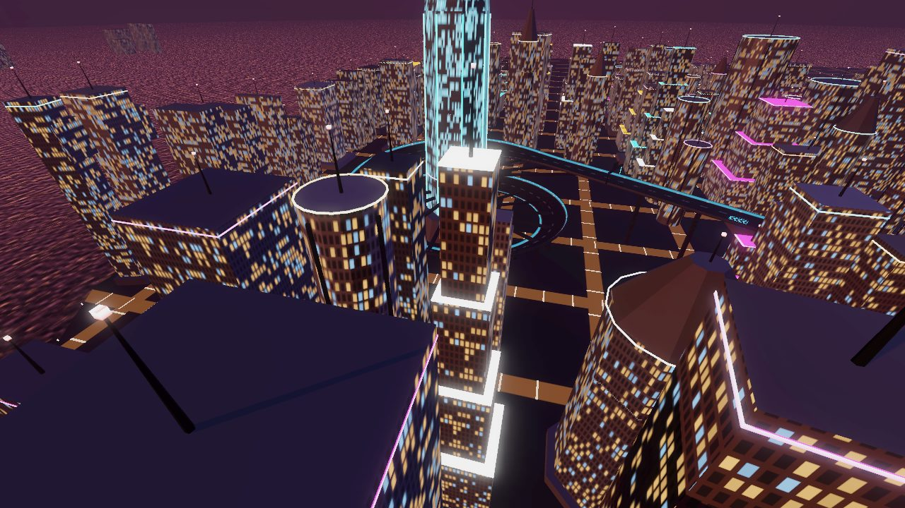
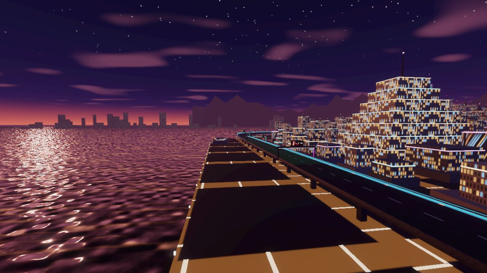
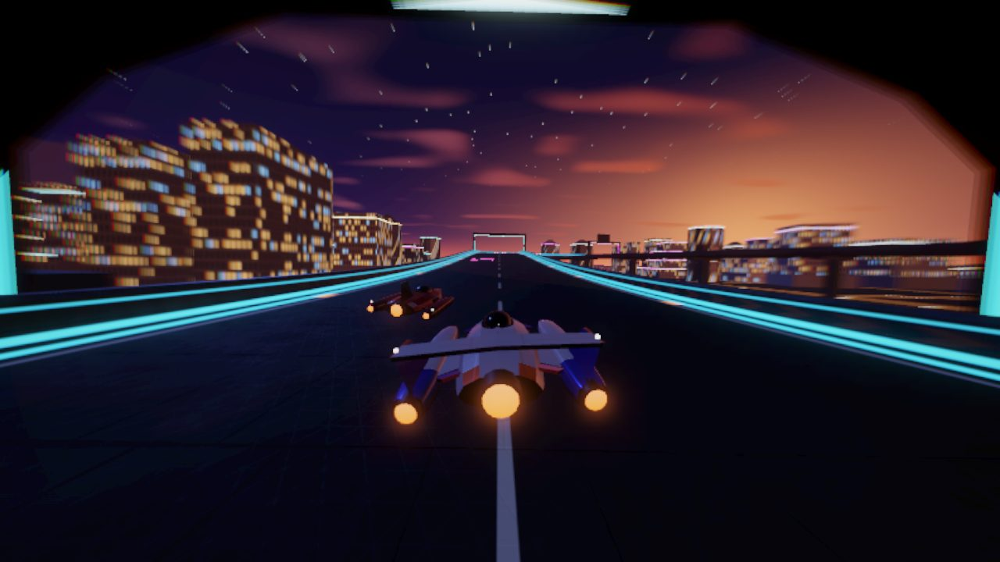
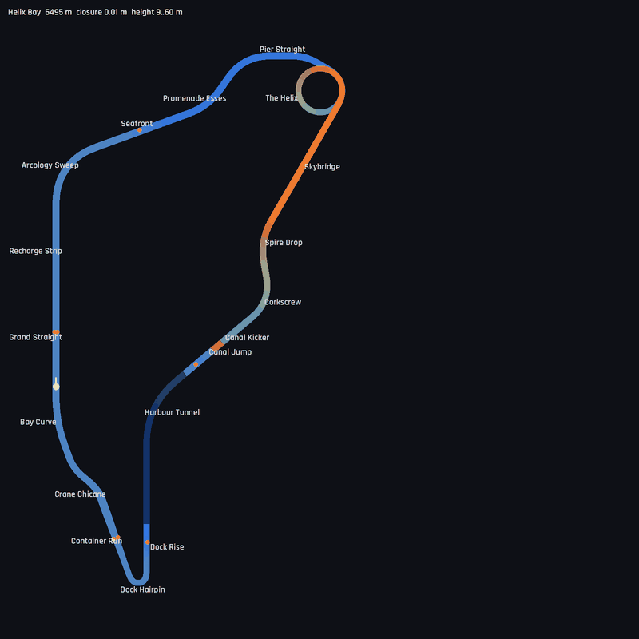

# Helix Bay: master demonstration circuit

6.5 km, clockwise, 9–60 m above the bay. Definition: `TrackLibrary._helix_bay()`. World:
`src/world/helix_bay.gd`. Map: `tools/dev.sh map helix_bay /tmp/hb.png`.

## Screenshots

<table>
<tr><td width="50%"> Seafront: the pack runs along the bay into the city at dusk</td><td width="50%"> The Helix: climbing round the Spire</td></tr>
<tr><td width="50%"> From above: the Helix ramp wound round the Spire</td><td width="50%"> The Grand Straight beside the bay, arcologies to the right</td></tr>
<tr><td width="50%"> Leaving the Harbour Tunnel</td><td width="50%"> Map (colour = height)</td></tr>
</table>

| # | Section | Length | Character | Design intent |
|---|---------|--------|-----------|---------------|
| 1 | Grand Straight | 760 m | Start/finish along the western sea wall, between twin arcologies; the last 320 m are the **recharge strip** (+4.5 shield/s, green chevrons); a pair of weapon pads | Launch, gantry with live start lights, shield recovery once per lap |
| 2 | Arcology Sweep | 420 m | 70° right, 12° bank, R≈244 m | Flat out at ARC; a lift or a touch of airbrake at NOVA+ |
| 3 | Seafront | 360 m | Gentle descent, boost pad on the left | Speed reference along the water |
| 4 | Promenade Esses | 520 m | Left 35° / right 55°, R≈273 m | Rhythm change. The racing line straightens the esses |
| 5 | Pier Straight | 43 m* | Short link (*a closure straight, solved by the builder) | Set-up for the Helix |
| 6 | **The Helix** | 864 m | 450° banked spiral (26°) around the 320 m Spire, +48 m | Signature corner: sustained load, the upper level visible overhead, a commitment test |
| 7 | Skybridge | 520 m | Exit at 60 m height, passes 48 m over the Helix entry; boost pad | Reward for a clean Helix exit, city panorama |
| 8 | Spire Drop | 260 m | 40° left while falling 18 m | Crest load. The speed profile keeps ships under the launch limit |
| 9 | Corkscrew | 260 m | 60° right while falling 12 m, 18° bank | Airbrake corner |
| 10 | Canal Kicker / Jump | 140 + 55 m | 5° kicker, 55 m gap over the Meridian Canal | Air time (1.47 s measured at ARC top speed), landing control |
| 11 | Harbour Tunnel | 720 m | Covered tube through the Harbour Arcology, light bars every 8 m | Strobing speed sensation, light sweeps over the hull |
| 12 | Dock Rise | 200 m | Climb out of the tunnel | Heavy braking zone |
| 13 | Dock Hairpin | 150 m | 160°, R≈35 m, 24 m wide | The technical corner: both airbrakes, then the inside one |
| 14 | Container Run | 320 m | 34 m wide, a central island splits two lanes; boost pad in the right lane | Alternative line: the right lane has the speed pad; the left lane gives the better entry into the Crane Chicane's first (left) turn |
| 15 | Crane Chicane | 280 m | Left/right 30° under the gantry cranes | Precision at speed |
| 16 | Bay Curve | 300 m | 20° right | Run onto the Grand Straight |

Lap times (ARC, measured): Elite autopilot 82.3–82.5 s; PRO AI best laps 82.7–88.3 s (3-lap race);
ROOKIE AI best laps 91.0–98.1 s (2-lap race).

## Pads

Boost pads (cyan): Seafront (left), Skybridge (right), Container Run right lane. Weapon pads (magenta): Grand Straight (both sides), Skybridge (left), after the jump landing (centre), Dock Rise (left), Container Run left lane. The AI drives over a reachable pad when it gains something from it.

## Fairness rules applied

- Every corner's curvature ramps in and out (no curvature steps), and banking follows the
  curvature profile.
- Crests stay under the speed that would lift the ship off (the racing line respects it). Only the
  marked kicker launches.
- Over the jump gap, invisible catch walls continue the barriers, so a ship cannot leave the track.
- Respawn puts the ship back at the last safe point if it wedges itself or falls.

## World layout

The sea lies west and north, with the docks and harbour in the south-west. A canal runs from the
north shore under the jump to an inland basin. The city is densest around the Spire and lower
towards the coast. A distant skyline across the bay and two layers of mountains to the east give
depth.
