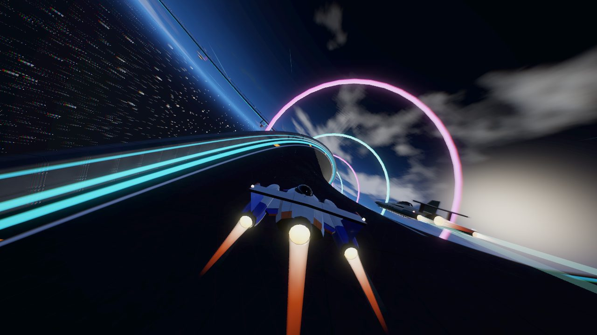
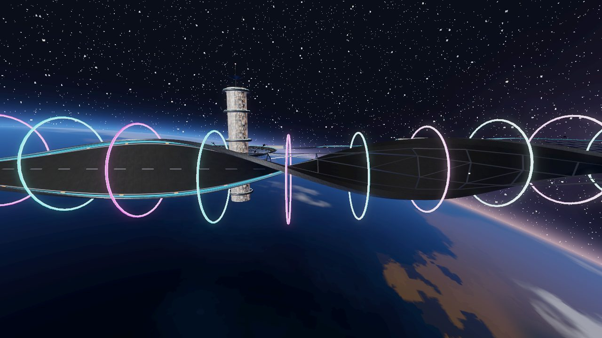
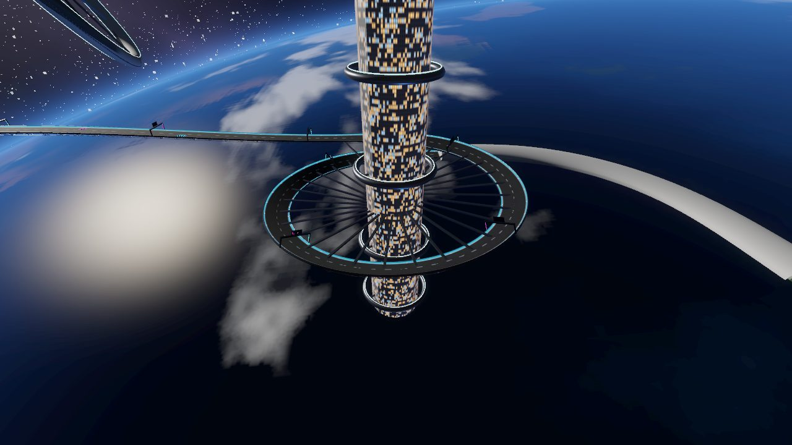
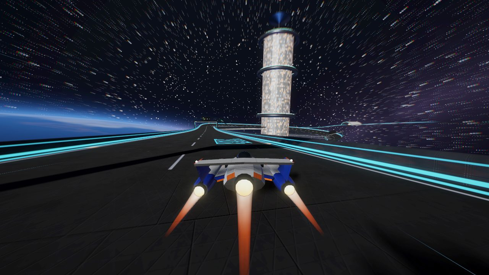
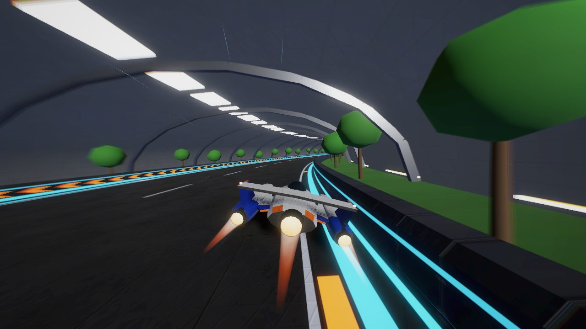
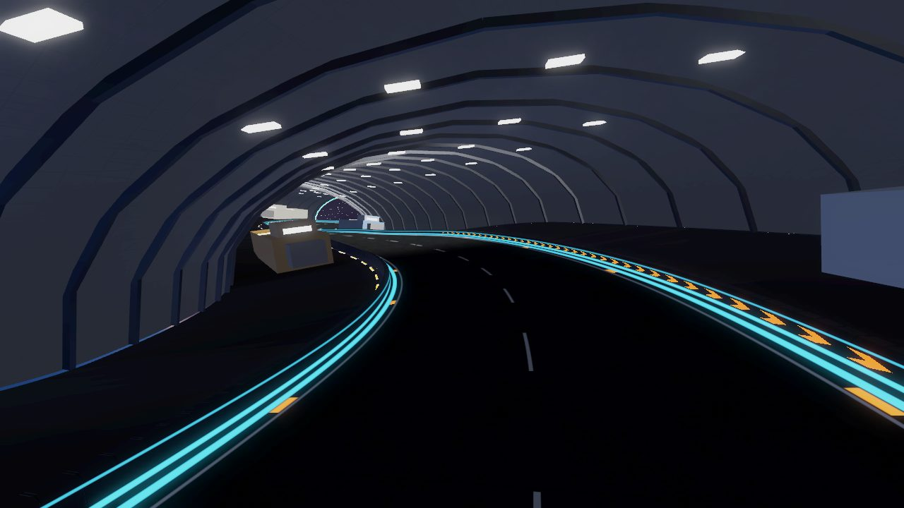
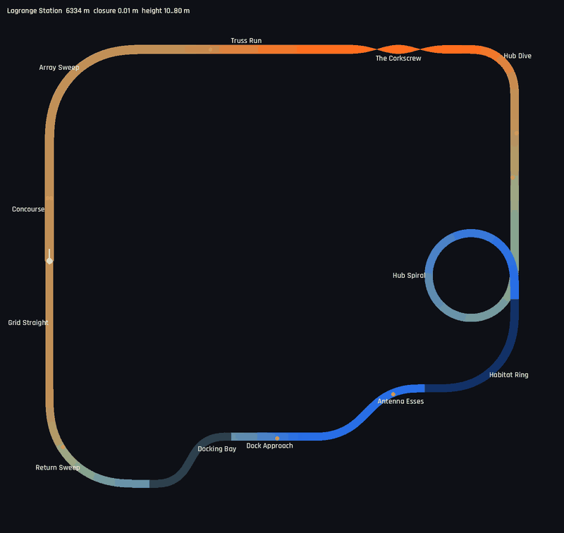

# Lagrange Station

6.3 km, clockwise, 10–80 m, a racing station in **low orbit**: no ground, no fog, the planet
below and the stars all around. It follows Helix Bay (dusk city), Glacier Ring (polar night) and
Atacama Spaceport (desert day). Definition: `TrackLibrary._lagrange()`. World:
`src/world/orbital.gd`. Map: `tools/dev.sh map lagrange_station /tmp/ls.png`.

## Screenshots

<table>
<tr><td width="50%"> The Corkscrew: the deck rolls a full turn above the clouds</td><td width="50%"> The Corkscrew from the side, ringed by hoops</td></tr>
<tr><td width="50%"> Hub Spiral round the station core, the planet below</td><td width="50%"> Approaching the station core</td></tr>
<tr><td width="50%"> Habitat Ring: garden terraces inside the tube</td><td width="50%"> Docking Bay: hangar with parked freighters</td></tr>
<tr><td width="50%"> Map (colour = height)</td></tr>
</table>

| Section | Character |
|---------|-----------|
| Concourse / Grid Straight | Start on the concourse: a recharge strip, weapon pads either side, the start gantry |
| Array Sweep | 90° right, banked 14°, with solar wings fanning out from the deck |
| Truss Run | 600 m climbing 20 m through girder portals every 30 m (light bars, red beacons) |
| The Corkscrew | 420 m in which the deck rolls a full **360°** around its centre line, ringed by alternating cyan and magenta hoops. The only rolling section in the game |
| Hub Dive | 90° right, diving 20 m and banked 12°, onto a 500 m descent toward the station core |
| Hub Spiral | One full 360° turn (radius 148 m) descending 30 m around the station core, passing 30 m under its own entry |
| Habitat Ring | 500 m, 90° right, inside a lit habitat tube with garden terraces and trees either side |
| Antenna Esses | ±45° |
| Dock Approach | Climb of 20 m to the bay (flex straight, boost pad) |
| Docking Bay | ±60° S-bend through a 30 m-wide arched hangar: lit ribs, side decks, four parked freighters, cyan portals at both mouths |
| Return Sweep | 90° right, climbing 30 m back to the concourse |

Measured (ARC, 3 laps, 7 AI, after the co-rotating lock below): player autopilot best lap 76.3–
77.1 s, AI best laps 74.8–81.3 s. There are no jumps and no airborne steps, the lowest hull height
is 0.98 m, and sustained slip peaks at 11–13° in the Hub Dive and Hub Spiral. Wall contacts above
4 m/s: 2 per race for the player, none of them in the Corkscrew. The closest approach between
separate parts of the lap on the same level is 285 m (from
`test_library_circuits_are_well_formed`). Closure error is 0.01 m, with the flex straights at 260
and 410 m.

## The Corkscrew and the co-rotating lock

The track builder gained a `roll` key: the segment's bank sweeps by that many degrees, eased like
any bank change. The bank is now stored and resampled with angle wrapping, so a 360° roll leaves
the frame continuous: the normal turns at most 2° per metre, checked by
`test_barrel_roll_holds_the_ship_upside_down`.

The first races showed what a rolling deck does to world-space physics. A point d metres off the
centre line rides a helix round it and needs a centripetal pull of w²·v²·d (w being the roll rate in
rad/m). That is about 18 m/s² at the barrier of this 420 m roll at 80 m/s, and nothing supplies it,
because the flux lock pulls only along the surface normal. Every AI ship was flung into the wall
mid-roll, every lap. The hull also trailed the deck by about 10°, and the hover gap alone swept the
ship sideways by h × roll (6 m per full turn). The fix is a **co-rotating lock** in `ShipPhysics`
(see `docs/HANDLING.md`). A hands-off ship 8–11 m off-centre now keeps its line through the roll
to within 1 m at 88 m/s, leaves it pointing straight, and its hull stays within 1° of the deck.
This is covered by `test_corkscrew_keeps_an_off_centre_line_hands_off`.

## World

- **Sky**: `sky_space.gdshader` draws three star layers, a dusty galactic band, the sun with
  glare, a moon with maria, and the **planet analytically**. A ray is cast against a unit sphere
  0.032 radii below the camera, with its axis tilted about 15° so the limb climbs toward the
  horizon on some headings. The surface has continents, shelf seas, deserts, high snow,
  domain-warped clouds, ocean glint, a dusk band and city lights on the night side, plus a
  scattering halo along the limb. Because it sits at infinity it is under the whole circuit and
  never clips. A 3400 m sphere mesh 5 km below was the first attempt, and it was almost never in
  frame. The shader does not use `TIME`, so the radiance cubemap is not re-rendered every frame.
- **Light**: a hard white sun with shadows, a dim blue planet-shine fill from below, a cool
  ambient and glow. Fog is disabled.
- **Structure**: a truss keel under the deck (frames, chords, diagonals, red and white navigation
  lights) instead of pylons. The Truss Run has girder portals. The station core is a 400 m lit
  tower inside the spiral, with collar rings, radial struts to the deck and a mast and dish on
  top. A wheel habitat (radius 520 m, eight spokes, window bands) turns slowly beyond the circuit.
- **Interiors**: the Habitat Ring and the Docking Bay are tube shells built along the track by
  section range, with inner and outer surfaces, ribs and floors between the barriers and the
  shell. The habitat is bright, with a lamp strip along the crown, grass terraces, trees and amber
  wall lights. The bay is a wide hangar with lamp rows, hazard strips, freighters with lit engines
  and windows, and cyan portals.
- **Gates**: the shared `HelixBay._gate` light gates with team logo boards, kept out of the
  Corkscrew, the Truss Run and the tunnels.

## AI notes

Two general changes came out of this circuit:

- **Edge guard** (`AIDriver.drive`): the driver predicts where its hull will be in 0.45 s and
  steers off a barrier before reaching it. Pure pursuit toward a line that runs along the edge
  overshot it by about a metre at steep crossing angles, which cost 4–5 wall hits a lap here. The
  guard does nothing when the ship runs parallel to the edge at the line's margin.
- **Gravity fade on rolled decks** (`ShipPhysics.planar_fade`): world gravity's share along the
  surface fades out once the deck is rolled past about 55° (full below 53°, zero beyond 78°), so the
  pull never swings sideways as the deck turns over. The racing line's bank help uses the same fade.
  Ordinary banks (≤20°) are unaffected.
