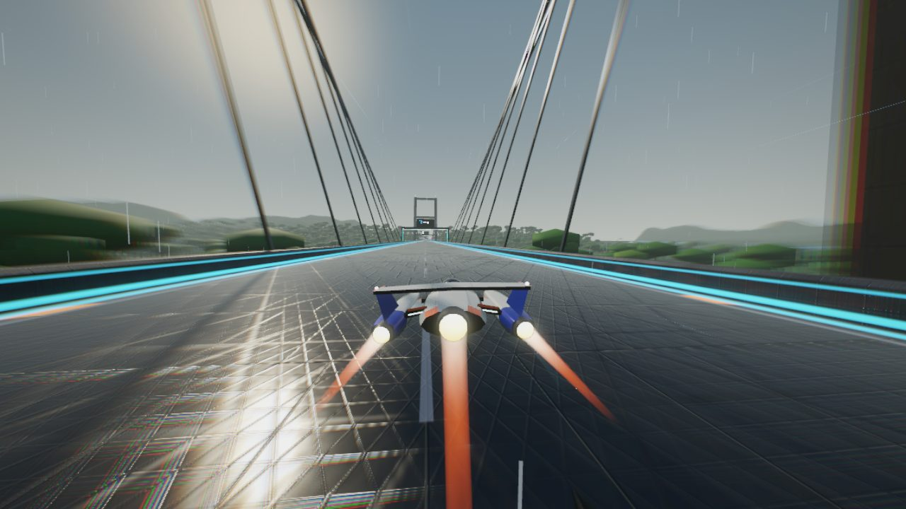
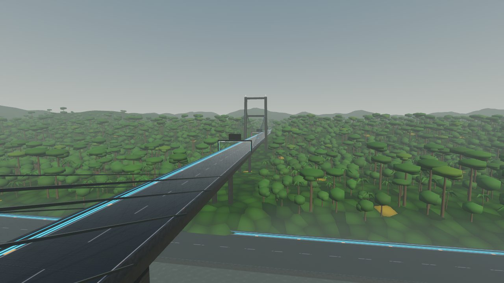
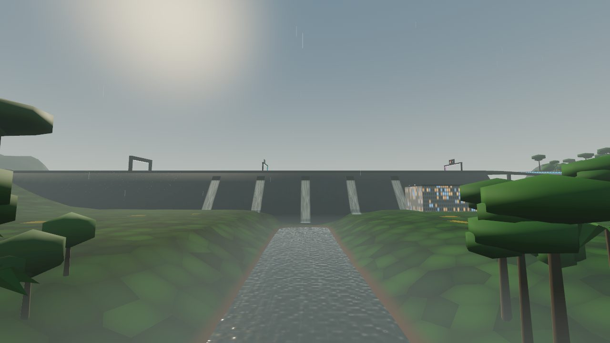
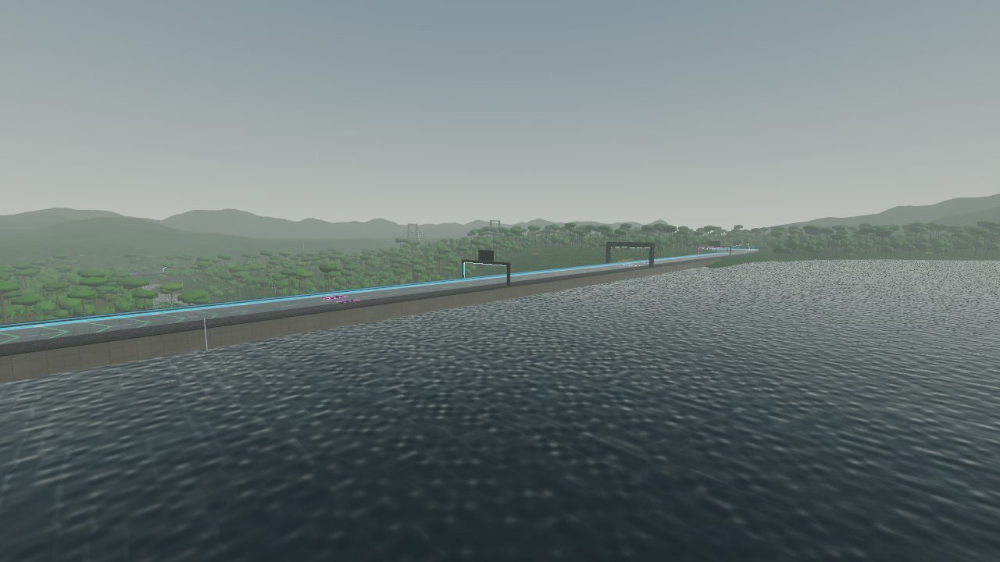
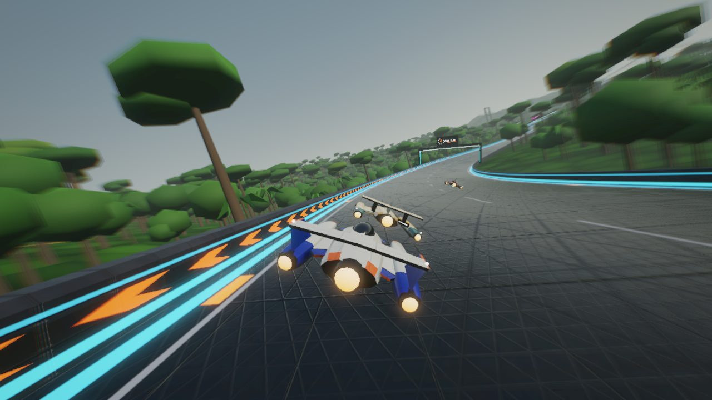
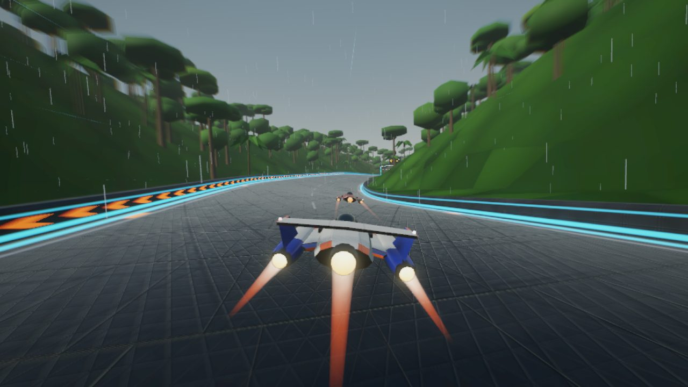
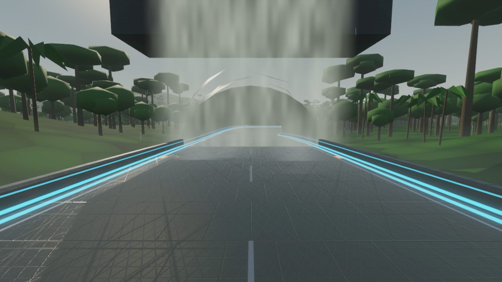
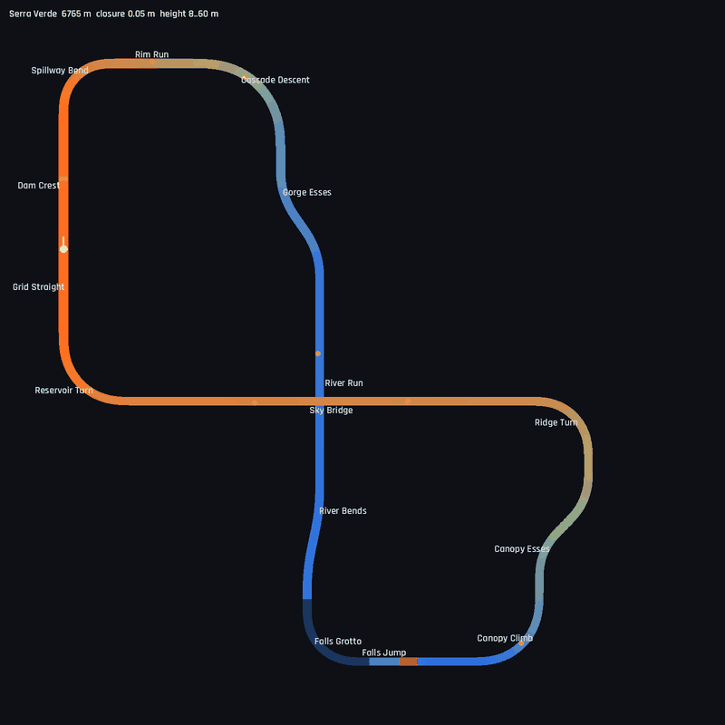

# Serra Verde

6.8 km, a **figure-eight**, 8–60 m. The fifth world: a rainforest gorge below a hydroelectric dam,
on a grey morning with light rain, low mist and a wet track. It follows Helix Bay (dusk city),
Glacier Ring (polar night), Atacama Spaceport (desert day) and Lagrange Station (orbit).
Definition: `TrackLibrary._serra_verde()`. World: `src/world/rainforest.gd`.
Map: `tools/dev.sh map serra_verde /tmp/sv.png`.

## Screenshots

<table>
<tr><td width="50%"> Sky Bridge: stays overhead, rain on the wet deck</td><td width="50%"> The Sky Bridge over the rainforest canopy</td></tr>
<tr><td width="50%"> The dam: outlet falls, powerhouse, the river leaving its foot</td><td width="50%"> The dam crest across the reservoir</td></tr>
<tr><td width="50%"> Spillway Bend, into the forest</td><td width="50%"> Canopy Climb through the valley</td></tr>
<tr><td width="50%"> The Falls Grotto exit through the curtain of water</td><td width="50%"> Map (colour = height; figure-eight crossing at the Sky Bridge)</td></tr>
</table>

| Section | Character |
|---------|-----------|
| Grid Straight / Dam Crest | Start on top of the dam (recharge strip, weapon pads). The reservoir laps the wall to the left; to the right the dam face drops about 42 m to the valley, with five outlets pouring down it and the powerhouse at its foot |
| Spillway Bend / Rim Run | 90° right off the dam, descending along the valley's upper slope (boost pad) |
| Cascade Descent | 90° right, banked 13°, diving 22 m into the gorge, with cascades running down the far wall |
| Gorge Esses | ±35° on the valley floor |
| River Run | 640 m straight on the river bank: the water starts just beyond the right-hand barrier. The Sky Bridge passes about 40 m overhead |
| River Bends | ±12° following the river |
| Falls Grotto | 90° left through a rock tunnel lit by lamps. The exit passes through a curtain of falling water |
| Falls Jump | 5.7° kicker, 60 m gap over the stream that drains the **Veil**, a 46 m-wide cascade off a cliff on the left. About 1.7 s of air at ARC |
| Canopy Climb / Canopy Esses / Ridge Turn | Climbing 40 m through the forest in cuttings, with ±45° esses and a 90° left onto the bridge |
| Sky Bridge | 1.26 km cable-stayed viaduct: two H towers 72 m tall with fans of stays, twin-column piers. It crosses the River Run and the river, 30–50 m above the valley floor |
| Reservoir Turn | 90° right, climbing back to dam level beside the lake |

The figure-eight's crossing is the Sky Bridge over the River Run. The test allows parts of the lap
to stack only with at least 12 m of vertical clearance; this crossing has about 40 m. The closest
approach between same-level parts of the lap is 337 m (`test_library_circuits_are_well_formed`).
Closure error 0.05 m; flex straights 639 m (River Run) and 1264 m (Sky Bridge).

Measured (ARC, 3 laps, 7 AI, difficulties 1 and 2): player autopilot best lap 79.2–79.6 s, AI best
laps 78.6–84.9 s, longest air 1.67 s, lowest hull height 0.98 m, peak slip 11.8–16°. Wall contacts
above 4 m/s: 0 at difficulty 1 and 1 (4.1 m/s) at difficulty 2. Galaxy A56 (High): lap-2 mean
60.0 fps, lowest 1 s sample 57, about 440k primitives (see `docs/PERFORMANCE.md`).

## Layout method

A figure-eight has zero net turning: lobe A turns right through 270°, lobe B left through 270°. A
turtle script mirroring the track builder searched the corner lengths with the River Run and the
Sky Bridge as the flex straights. Those two are perpendicular, so the closure is well conditioned.
The search kept candidates with at least 60 m between same-level parts and ranked them by
clearance and a target length of about 6.8 km. The first topology hairpinned lobe B south of
everything, so the bridge never crossed the river. The fix was to make lobe B turn left
(counter-clockwise) east of the waist.

The Cascade Descent was lengthened from 480 to 540 m (radius 216 → 243 m) after the first races.
The real cause of its slides was the AI controller (see below), but the wider corner is also
fairer for a human driver.

## World

- **Sky, light, weather**: overcast procedural sky, warm soft sun, height fog that thickens below
  24 m (mist in the valley), rain streaks in a box kept ahead of the camera, and spray at the foot
  of each fall. The track shader gained a `wetness` term: darker deck and glossy puddles that
  reflect the sky. It is reset to 0 for every other circuit, because the material is shared.
- **Terrain**: the shared height field and track distance field, plus distance fields for the
  river and the stream (`_poly_field`: the same two-pass propagation, for any polyline). There is
  a plateau at 58–70 m with mountains beyond. Below the dam a broad valley about 18 m deep follows
  the river, so the bridge has something to fly over. Above the dam, the reservoir basin is a
  funnel that opens out from the dam face, so the lake (at 54 m) touches the dam and nothing else
  floods. The river gorge is carved to 2 m below the water. The stream ravine sharpens at the
  Veil's pool, and a cliff rises behind the Veil. The shader (`jungle.gdshader`) draws canopy
  crowns only on gentle ground (on slopes they smeared into long streaks), wet mossy rock with
  run-off streaks on steep faces, and clay banks at the waterline.
- **River path**: derived from the track. It leaves the dam foot, swings into the gorge, runs 30 m
  off the River Run's right side, then carries on downstream past the grotto with a gentle
  meander. At 48 m the bank hid the water from the cockpit; at 30 m the water starts just past the
  barrier.
- **Water**: one plane at river level that shows only where the gorge and ravine are carved below
  it, and the reservoir plane upstream of the dam. The shared water shader gained `ripple` and
  `chop` uniforms. Its harbour-scale ripples looked like cartoon blobs up close.
- **Structures**: the gravity dam lofted along the crest (1:0.75 downstream face, five outlet
  gates with falls draped down the face, a powerhouse with penstocks), the Sky Bridge, and the
  grotto (tube interior plus a lumpy rock exterior, a rock lip over the exit, and the curtain).
- **Forest**: about 17,600 instanced trees on High, in three low-poly kinds (emergent giants with
  umbrella crowns, broadleaf, palms), with per-instance tint and rare yellow flowering crowns. They
  are grouped in 400 m cells with a 900 m visibility range and kept out of the corridor, water,
  steep slopes, the dam's face and toe, the bridge towers, and the falls and their views. Density
  scales with the preset (`city` factor). Beyond about 650 m the terrain shader carries the canopy.

## AI note: the slip guard

At difficulty 2 the autopilot hit the inside wall in the Cascade Descent every lap, with slip
building to 30°. The trace showed a late turn-in, then full steering plus the inside airbrake for
over a second. That asks for about 1.7× the yaw rate the keels can turn the velocity through: 0.8
rad/s commanded against 0.36 needed and 0.42 available. The nose over-rotates and the ship slides
across the track. `AIDriver` now eases the steering, keeps the inside airbrake out, and lifts a
little once the nose points more than 6° inside the direction of travel. Peak slip fell from 29.7°
to 11.8° here. Helix Bay and Lagrange still have no wall hits, and the handling bench's AI laps
changed by under 0.1 s.

## Development aids added

- `--views=s,d,h,look_s,look_d;...` (DevCapture): fixed scenery cameras placed in the track frame,
  one shot each into `--shots`. Used to judge the dam face, lake, bridge, falls and grotto, which
  the chase camera never frames.
- `--dump-terrain=out.png` (Rainforest): a plan of the height field with the track, river and
  stream drawn over it, plus cross-sections, which explained the hidden river and the missing
  lake.
