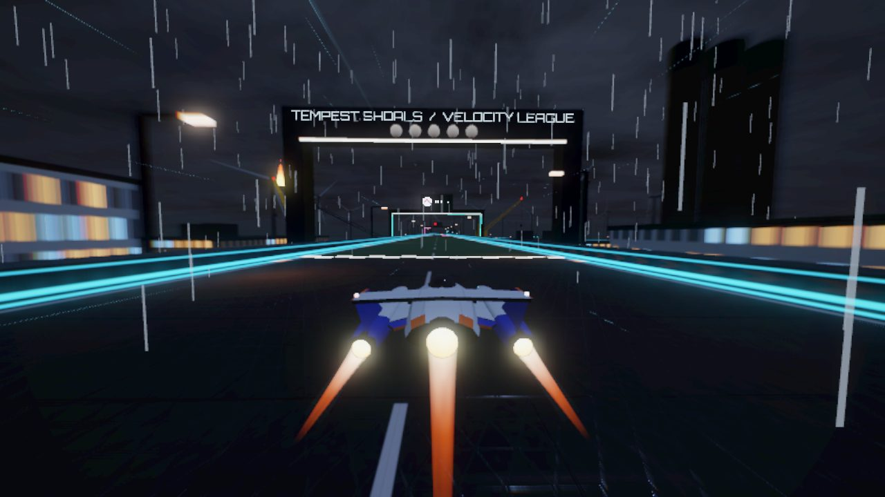
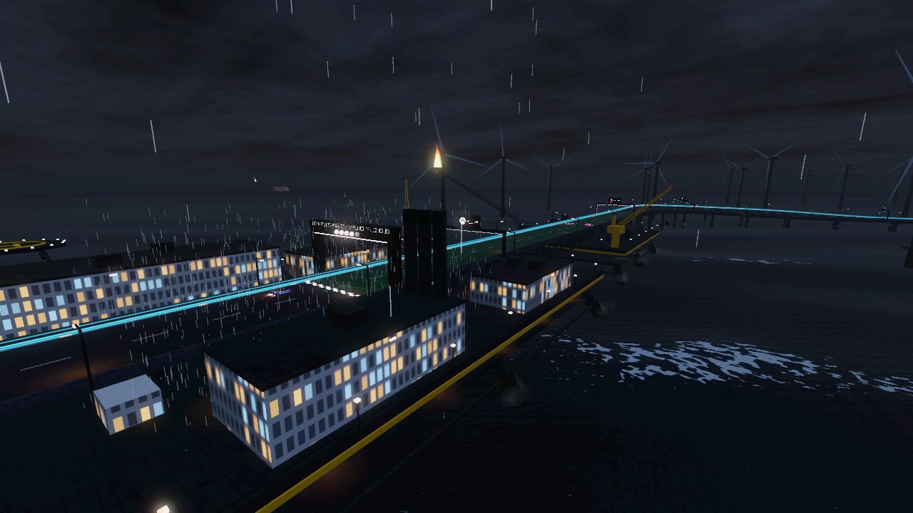
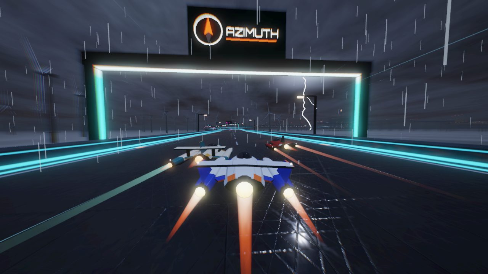
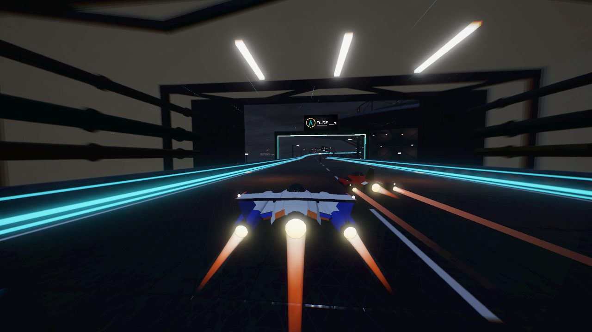
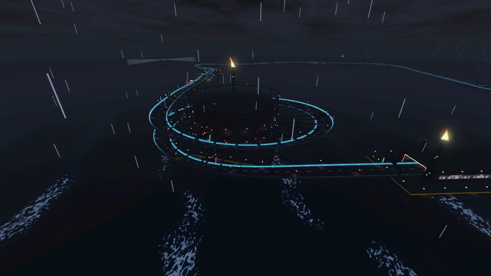
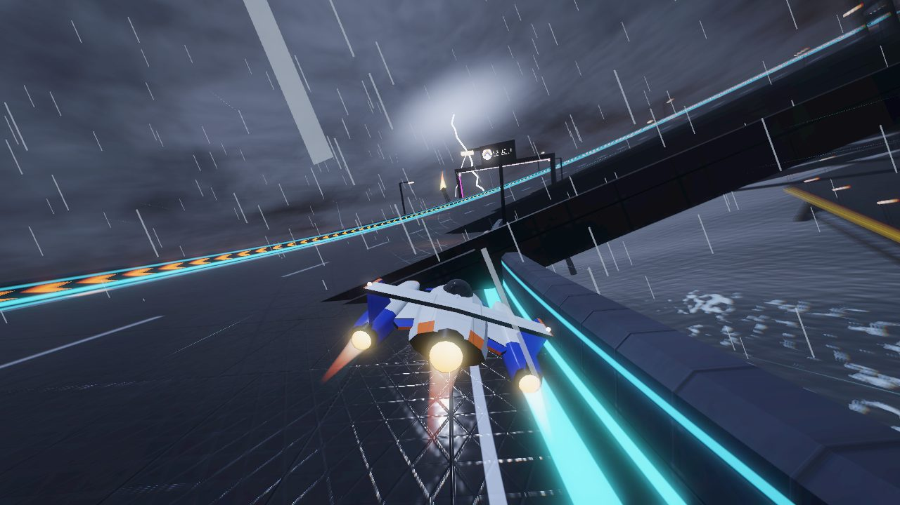
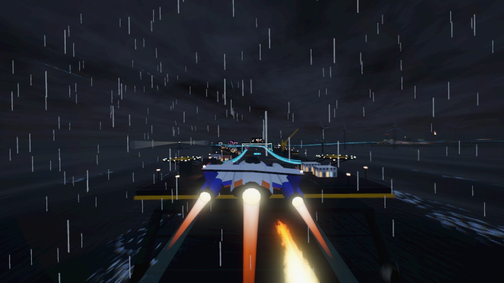
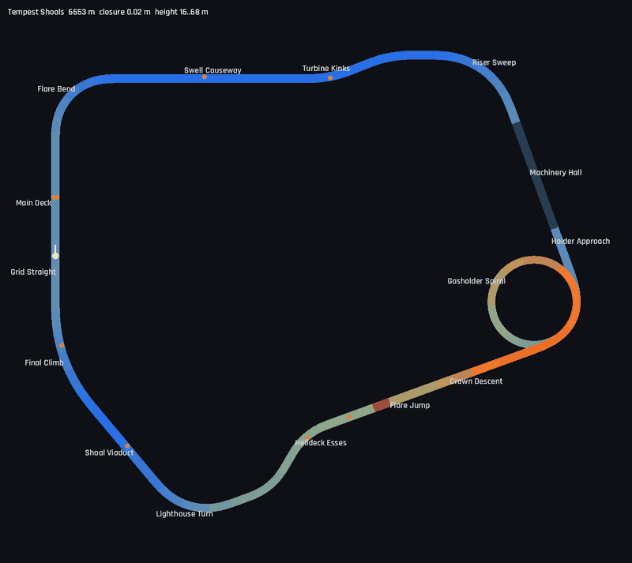

# Tempest Shoals

6.65 km, clockwise, 16–68 m above the sea: a circuit through a cluster of **offshore energy platforms
in a night storm**. There is no land, only open sea with a heavy swell, driving rain and lightning.
The track is elevated everywhere, on platforms, viaducts and towers. Definition:
`TrackLibrary._tempest_shoals()`. World: `src/world/offshore.gd`. Map:
`tools/dev.sh map tempest_shoals /tmp/ts.png`.

## Screenshots

<table>
<tr><td width="50%"> Main Deck: the start gantry between the accommodation block and the derrick</td><td width="50%"> The Main Platform from the air: accommodation, process modules, cranes, the flare beyond</td></tr>
<tr><td width="50%"> Swell Causeway: a strike beyond the wind farm</td><td width="50%"> Machinery Hall: lamp rows, roof trusses, pipes and turbine bays</td></tr>
<tr><td width="50%"> The Gasholder Spiral wound round the tank, from outside</td><td width="50%"> Climbing the spiral during a strike, the sea 50 m below</td></tr>
<tr><td width="50%"> Flare Jump: over open sea, the flare below, helipads on the landing platform</td><td width="50%"> Map (colour = height; the spiral passes 30 m over its own entry)</td></tr>
</table>

| Section | Character |
|---------|-----------|
| Grid Straight / Main Deck | Start on the Main Platform, 30 m above the sea: recharge strip, weapon pads, start gantry. On the left, the accommodation block (helideck on its roof, lifeboats under the deck edge). On the right, process modules with exhaust stacks, a derrick and two cranes |
| Flare Bend | 90° right, banked 12°, dropping 14 m off the platform. The Flare Platform's boom burns out over the sea on the outside of the bend |
| Swell Causeway | 617 m straight (flex) on a low viaduct 16 m above mean sea level, on twin concrete piers. Spray rises where the swell breaks on the piers. Boost pad |
| Turbine Kinks | ±22° through the wind farm |
| Riser Sweep | 70° right, banked 10°, climbing 12 m to the process platform |
| Machinery Hall | 400 m straight tunnel through a steel shed: gas turbine bays with ducts to the roof, pipes along the walls, roof trusses, lamp rows and a gantry crane. Stacks with red beacons on the roof |
| Holder Approach | 120 m bridge to the gasholder |
| Gasholder Spiral | 1.4 km, **450° right** at a radius of about 156 m, banked 18°, climbing 40 m round a gasholder in its lattice guide frame. Radial arms from the frame carry the deck. The last quarter runs 30 m above the first |
| Crown Descent | 400 m, dropping 20 m on braced lattice towers |
| Flare Jump | 100 m kicker off the take-off platform, then a 60 m gap over open sea above a burning flare (its flame tip about 10 m below the flight path). About 1.7 s of air at ARC, landing on the Helideck Platform |
| Helideck Esses | ±40° across the Helideck Platform, with a helipad on each side of the landing |
| Lighthouse Turn | 70° right, banked 12°, descending 16 m. A lighthouse stands on a rocky shoal 560 m outside the turn |
| Shoal Viaduct | 250 m low viaduct, 20 → 16 m. Boost pad |
| Final Climb | 40° right, climbing 14 m back onto the Main Platform |

The only stacked part of the lap is the spiral's last quarter over its first. Where the two are
less than 45 m apart horizontally, they are at least 30.2 m apart vertically (computed from the track
data). The closest approach between same-level parts of the lap is 250 m
(`test_library_circuits_are_well_formed`). Closure error 0.02 m; flex straights 617 m (Swell
Causeway) and 112 m (Grid Straight: the 8-ship grid needs about 65 m). The tightest radius is 156 m
in the spiral; every other corner is 190 m or more. Width 30 m, 28 m in the hall, the spiral and the
esses. The lowest deck is 16 m above mean sea level; the box girder under it clears the highest
crest of the swell by about 8 m.

Measured (ARC, 3 laps, 7 AI, headless at 4× time scale): player autopilot best lap 76.8 s at
difficulty 1 and 77.2 s at difficulty 2; AI best laps 77.3–82.3 s and 75.6–78.6 s. At difficulty 2
all eight finished. At difficulty 1 the autopilot won and the run ended with the AI on their last lap
(estimated times, none eliminated). Longest air 1.67 s (the Flare Jump), lowest hull height 0.97 m
(on the kicker lip). No wall contacts above 4 m/s at either difficulty. Peak slip is 6.5° at
difficulty 1. At difficulty 2 it reaches 8.7° in the spiral, with single spikes of 10.7–11.9° in the
pack and a 16.9° yaw while airborne over the gap on the first lap; none of them repeats at the same
spot.

## Layout method

A turtle script mirroring the track builder laid out the corners. The first draft, with a 360°
spiral on a plain rectangle, came out at 7.5 km. Making the spiral 450°, so that it also turns
the south-east corner, shortened the lap and stacks the spiral's last quarter over its first. A search
then varied corner lengths and angles (Flare Bend 90–100°, Riser Sweep 60–90°, a turn in the hall
0–15°, Final Climb 25–40°). The Swell Causeway (heading east) and the Grid Straight (heading north)
were the flex straights; being perpendicular, they keep the closure well conditioned. Candidates
with a lap of 6.2–7.0 km and sensible flex lengths were ranked by same-level clearance (about 295 m
for all the leaders, set by the spiral itself). The turtle used the default ease for the spiral.
With the 0.15 ease of the real spec the Grid Straight solved to 112 m instead of 235 m, still
enough for the grid.

Heights: the Main Platform at 30 m, the low viaducts at 16 m, the spiral from 28 to 68 m, the jump
from 50 m. Rises sum to zero, with the Final Climb absorbing the remainder.

## World

- **Sky and light**: `sky_storm.gdshader` draws a low cloud deck from a baked texture
  (`offshore_clouds.png`: density, detail, wind-stretched rolls; two fetches per pixel). It is lit
  faintly from above by a hidden moon and has a sodium glow low on the horizon. It does not use
  `TIME`, so the radiance map renders once. The moonlight comes from high overhead: a low moon
  left bright glare streaks on the wet, normal-mapped deck. Its specular is turned down, and it
  casts **no shadows** (none would show at night under cloud, and it saves the shadow pass on
  mobile). Ambient light is a fixed blue-grey; the fog matches the sky's horizon colour, with a
  little extra height fog over the water. The track is wet (`wetness` 0.95).
- **Lightning**: the `Storm` node fires a strike every 7–15 s, 1.1–1.9 km away and within 31° of
  the camera's heading, so most are seen. One envelope (three return strokes, then an afterglow)
  drives the sky brightness (`Environment.background_energy_multiplier`), the fog colour, the
  ambient energy, a shadowless directional flash light, the sea's `flash` uniform and the bolt
  mesh (`lightning.gdshader`: additive, fog-free, two ribbons and a faint glow card in the cloud
  base). A strike only changes uniforms and energies: no node is created and no shader compiles.
  The flash light stays in the scene at zero energy between strikes. Thunder follows after a
  shortened sound delay, quieter for far strikes. The rumble (and a looping rain hiss) is
  synthesised once at build time as an `AudioStreamWAV` on the SFX bus. No strike starts while the
  camera is inside the Machinery Hall.
- **Sea**: a polar grid around the camera (79 rings spaced 2 m + 6 % of the radius, out to 3.6 km,
  128 segments, 20.7k triangles), moved under the camera every frame. `sea_swell.gdshader`
  displaces it in world space by four Gerstner waves of 37–160 m (`swell.gdshaderinc`, peak crest
  3.7 m), so the waves stay put while the grid slides. The shorter waves fade with distance, where
  the grid is too coarse to carry them. The fragment adds the small chop from two fetches of
  `offshore_sea.png` (normal map, foam in alpha) and spreads foam over the crests. The foam pattern
  is histogram-equalised, so the shader's threshold maps directly to coverage. A little
  self-light on the foam keeps the whitecaps readable at night.
- **Rain and spray**: wind-slanted streaks (1,900 × the `particles` preset factor) in a box just
  ahead of the camera, switched off under the hall roof. Spray rises at the piers and legs: one
  emitter per 450 m cell, spawning from that cell's pier positions (an emission-point texture).
- **Supports**: on the low viaducts, twin concrete piers every 46 m with a dark splash zone and a
  cap beam. On the high sections, four-legged braced lattice towers. A box girder runs under the
  deck. Sodium lamp posts stand every 40 m on alternate sides, each with an additive light pool on
  the wet deck. Light gates stand every 230 m.
- **Platforms**: one jacket rig builder (battered tubular legs, cellar and main decks, yellow
  fascia, railings, sodium lamps on the edges and under the deck) and pedestals that carry the
  track deck over the rigs. Blocks, cranes and deck clutter (containers, tanks, pump skids, huts)
  are only placed where a spatial hash of the track says they keep clear of the racing corridor.
  The Main and Flare Platforms carry the start. The Machinery Hall has a lit lining inside and grey
  cladding outside. The gasholder (tank, dome, a 16-column guide frame with ring girders, sodium
  washes on the tank, a flare stack on the crown) stands on a round rig inside the spiral. The jump
  has its own take-off rig and the two-part Helideck Platform.
- **Wind farm**: 63 turbines on High and Ultra (thinned by the `city` preset factor below that),
  outside the circuit beyond the causeway, at least 95 m from the centre line. Instanced: towers with red lights that blink in step
  (`beacon_blink.gdshader`), and rotors spun in the vertex shader (`turbine_rotor.gdshader`,
  per-instance phase and speed).
- **Landmarks**: the lighthouse on its rocky shoal, whose two additive beam cones sweep on a
  spinning pivot. Six production platforms on the horizon (three on Low), 0.7–1.6 km beyond the
  circuit's bounding circle, with derricks and flare booms. Every gas flame is in one additive mesh (three crossed quads leaning
  downwind; `flare_flame.gdshader` cuts the tongue out of the cloud texture).

## Notes

### The speed post pass hid transparent geometry (shared fix)

`SpeedFx`'s full-screen post quad (radial blur, aberration, vignette) samples the screen texture,
whose copy holds only the opaque pass, and the quad was sorted to draw last
(`sorting_offset = 1000`). Whenever the pass was on (the motion blur setting, at speed), it wrote
that copy over everything transparent drawn before it. The lightning bolt showed in fixed-camera
shots but never in race shots. Disabling the pass for one test run brought back the bolt, the rain
and the engine plumes. The fix is one line in `SpeedFx._post()`:
`post_mat.render_priority = Material.RENDER_PRIORITY_MIN`. The pass now draws first among
transparent objects, and they composite on top (unblurred). This was verified on this circuit
only, but the cause is shared, so the same transparent effects on the other circuits (rain, falls,
plumes) should now show at speed with motion blur on.

### Performance

- The shared track mesh is 277k triangles for this lap (about 42 per metre). From the top of the
  spiral most of the open-sea circuit is in view, which sets the primitive peaks. The scenery
  totals about 108k triangles, merged per structure or per 450 m cell (`--world-stats` lists
  them).
- Desktop (Intel Arc integrated GPU, auto preset Ultra, 1280×720 window, one lap with 8 ships,
  89 one-second samples): draw calls median 128, max 182; primitives median 165k, max 327k (top of
  the spiral; 250–280k on the Flare Bend and the causeway, looking across the wind farm). The race's
  own fps median was 60 in every run. The lowest one-second samples (18–49 fps over three runs) fell
  on the spiral and the causeway and followed the load from other processes on the machine. A
  run with eight forced strikes showed no consistent difference from one without (one 47 fps sample
  against 56–60).
- World build: 0.4–0.9 s on the desktop in headless and windowed runs (it varied with machine
  load from other processes). Trackside and platforms dominate. A lean local box and beam (no UVs:
  these materials are triplanar or plain) is about 2.5× faster than `MeshKit.beam`, and the world
  builds thousands of them.
- Not yet measured on the phone.

## Development aids added

- `--strike-at=t1,t2,...` (Offshore): lightning strikes at these times (seconds on the storm's
  clock, which runs within a frame or two of DevCapture's `--shot-at` clock) instead of random
  ones, for screenshots. `--storm-log` prints each strike's placement and screen position.
- `--world-stats`: triangles per world node, largest first.
- `tools/gen_offshore_textures.py`: the cloud and sea textures (numpy + Pillow, deterministic).
