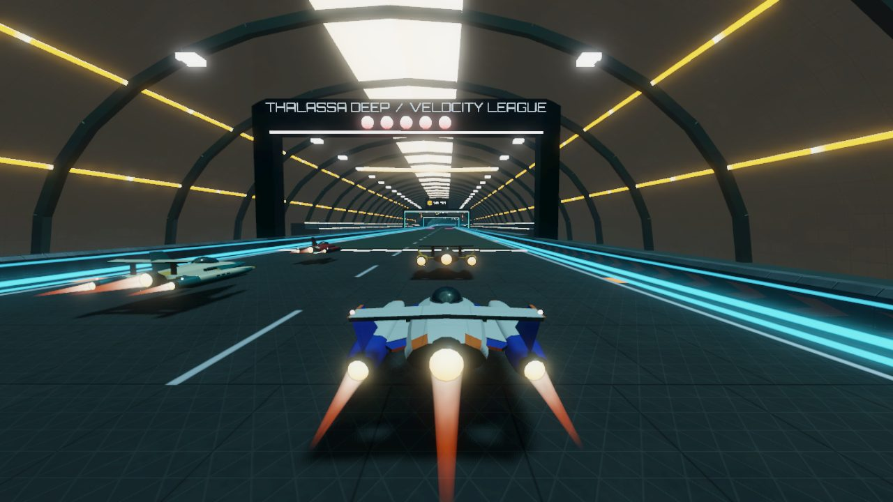
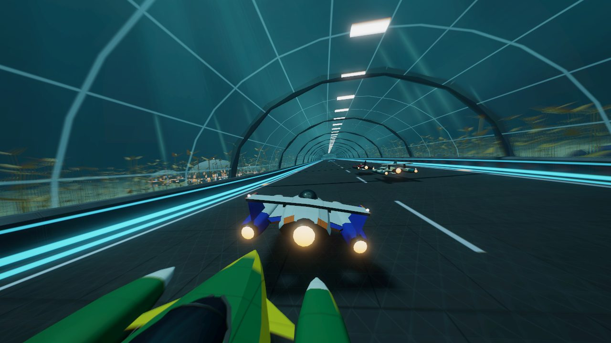
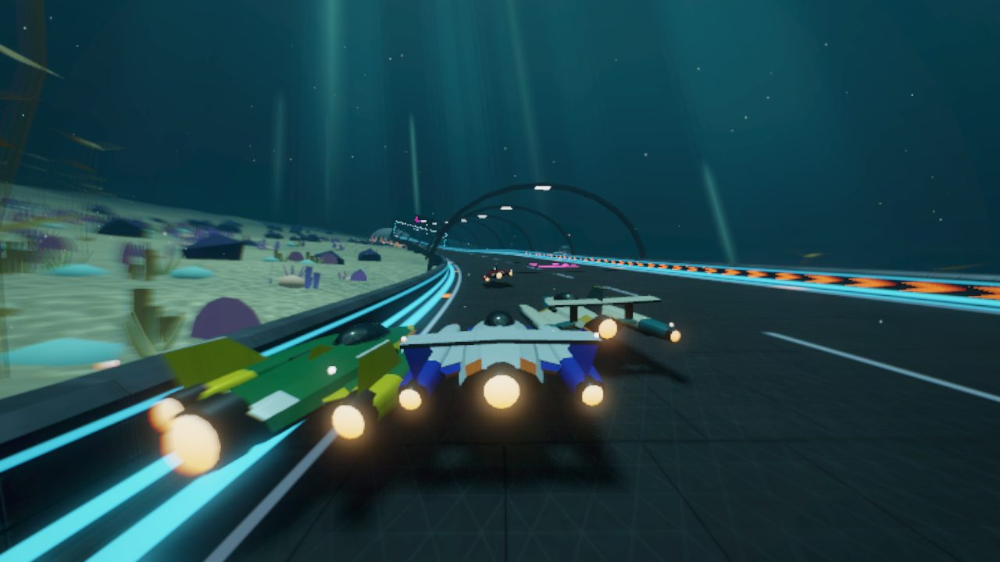
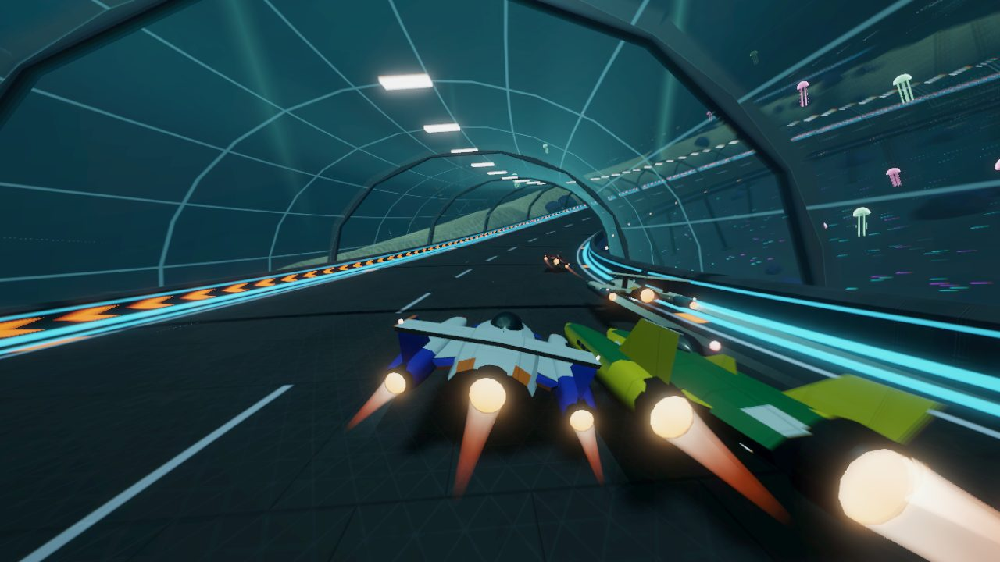
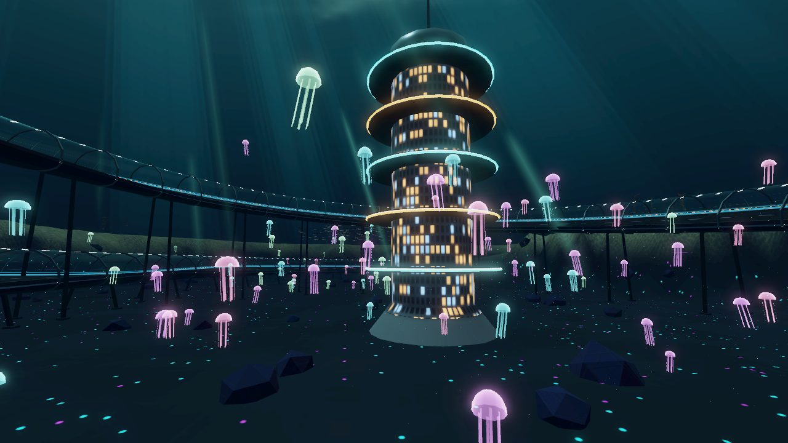
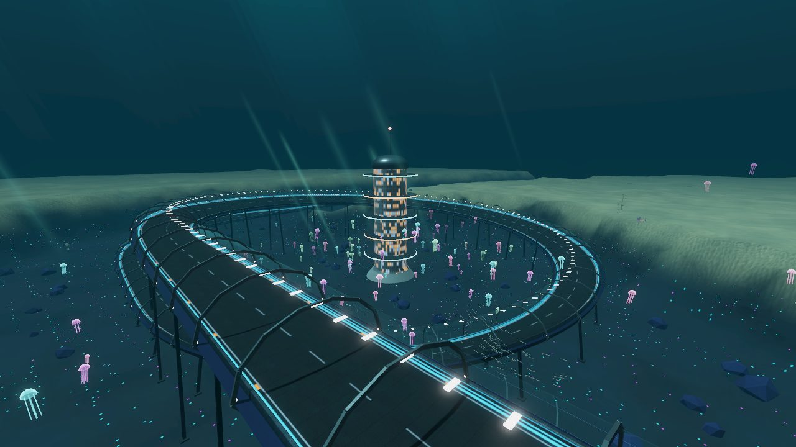
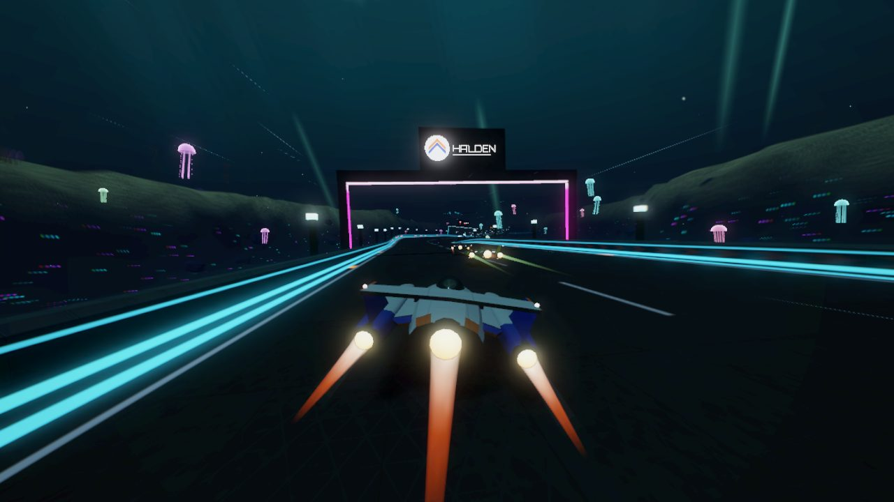
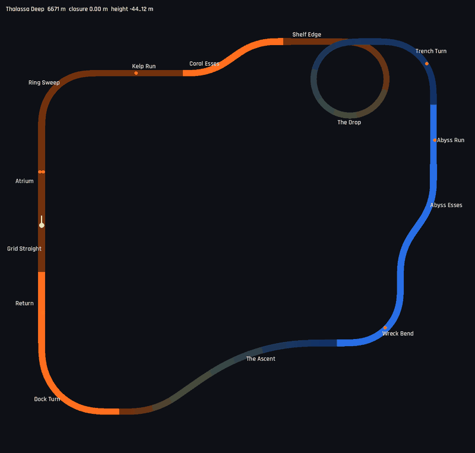

# Thalassa Deep

6.7 km, clockwise, −44 to +12 m: an undersea research city on the edge of a continental shelf.
The whole lap is underwater. Ships race through pressurised glass tubes, across an open reef
causeway, down a spiral in a blue hole, along the floor of a trench, and back up through the shelf
in a rock tunnel. It follows Helix Bay (dusk city), Glacier Ring (polar night), Atacama Spaceport
(desert day), Lagrange Station (orbit) and Serra Verde (rainforest). Definition:
`TrackLibrary._thalassa_deep()`. World: `src/world/abyssal.gd`. Map:
`tools/dev.sh map thalassa_deep /tmp/td.png`.

## Screenshots

<table>
<tr><td width="50%"> The Atrium: the start hall under its skylight</td><td width="50%"> Kelp Run: the glass tube through the kelp forest</td></tr>
<tr><td width="50%"> Coral Esses: the open causeway over the reef</td><td width="50%"> The Drop: the spiral tube, its lower turn below on the right</td></tr>
<tr><td width="50%"> The blue hole: the Spine, jellyfish and the spiral round it</td><td width="50%"> The Drop from above the rim</td></tr>
<tr><td width="50%"> Abyss Run: the trench floor, 44 m down</td><td width="50%"> Map (colour = height; The Drop passes 52 m under its own entry)</td></tr>
</table>

| Section | Character |
|---------|-----------|
| Grid Straight / Atrium | Start inside the Atrium, a vaulted habitat hall 580 m long and 22 m high: side decks with lit grandstands, portholes, a skylight strip along the crown, two team gates, the start gantry. Recharge strip and weapon pads. Outside, a domed habitat with lit windows stands over the line |
| Ring Sweep | 90° right (radius 203 m), banked 12°, into the first glass tube. The research campus (domes with lit windows, walkway pipes) lies inside the curve |
| Kelp Run | 330 m straight in the tube (flex straight, boost pad) through the kelp forest, with sun shafts slanting down |
| Coral Esses | ±35° on an open causeway: arches every 24 m over a reef bank a few metres under the deck, with coral, sponges, sea fans and schools of fish |
| Shelf Edge | 200 m of tube out over the rim of the blue hole |
| The Drop | 1150 m, one full 360° right turn (radius 161 m), banked 18°, descending 52 m in the glass tube round the inside of a blue hole. The Spine, a lit lift shaft, stands in the middle; jellyfish drift round it and the floor glows. The exit passes 52 m under the entry |
| Trench Turn | 90° right (radius 202 m) in the tube, out of the hole into the trench |
| Abyss Run / Abyss Esses | The trench floor at −44 m, open: marker posts with blue lamps every 24 m, the deep laboratory's domes, jellyfish, bioluminescent silt. The Drifters (below) swim overhead. ±35° esses follow the trench's meander (boost pad) |
| Wreck Bend | 90° right (radius 202 m) past a freighter lying broken in two on the trench floor, lit by survey floodlights |
| The Ascent | 1 km rock tunnel climbing 56 m through the shelf with a −35°/+35° kink: lined bore, continuous light lines along both walls, a crown lamp every 8 m, concrete portal facades at both ends |
| Dock Turn | 90° right (radius 249 m) on the reef bank past the submarine pens: a docking tower, a pier and two moored submarines |
| Return | Flex straight back into the Atrium (boost pad) |

Glass tubes cover about 2.6 km of the lap, the hall 0.6 km and the rock tunnel 1 km; the other
2.5 km are open. The only stacked section is The Drop, whose exit runs 52 m under its entry. The
closest approach between same-level parts of the lap is 339 m
(`test_library_circuits_are_well_formed`). Closure error 0.00 m; flex straights 332 m (Kelp Run)
and 265 m (Return).

Measured (ARC, 3 laps, 7 AI, headless at 4× time scale): player autopilot best lap 76.9 s
(difficulty 2) and 77.3 s (difficulty 1); AI best laps 75.9–78.3 s at difficulty 2 and 77.2–82.0 s
at difficulty 1. At difficulty 1 the last three AI were 7–13 s behind and still on their final
lap when the race ended, so their totals are estimates. No airtime, lowest hull height 0.98 m. Sustained slip in the corners peaks at
6–9° (The Drop, Ring Sweep, Trench Turn, Wreck Bend); the 11–17° peaks on the Atrium straight are
contact with other ships just after the start. Wall contacts above 4 m/s: none at difficulty 1,
one at difficulty 2 (6.1 m/s in the Coral Esses on lap 1, in traffic). The Drop is taken at 71–90
m/s.

## Layout method

The lap is a clockwise loop (360°) with a full extra turn for The Drop, so the turning sums to
720°. A turtle script mirroring the track builder searched the lengths of the Ring Sweep, Shelf
Edge, The Drop, Trench Turn, Abyss Run, Wreck Bend, Ascent and Dock Turn, with the direction of
the Abyss Esses and of the Ascent's kink. The Kelp Run (east) and the Return (north) are the flex
straights; they are perpendicular, so the closure is well conditioned. The search kept variants
with both flex straights over 150 m and a lap of 6.3–7.0 km, and ranked them by the clearance
between same-level parts. The Drop's length was then set for a radius above 150 m: 1150 m for
360° with a short ease gives 161 m. Heights: the shelf sections run at +12 m (deck over a seabed
at about 0 m), The Drop descends 52 m and the Trench Turn 4 m more, and the Ascent climbs the 56 m
back in two halves.

## World

- **Water**: no sky. `sky_abyss.gdshader` draws the water column: blue-black below, teal toward
  the surface, a brighter rippled disc overhead (Snell's window) with the sun's glare, and a fan of
  shafts. It has no `TIME`, so the radiance map is rendered once. Exponential fog, blue-green.
  `Abyssal.DepthTint` follows the camera: the fog, ambient light and sun get darker and bluer with
  depth (sun 1.2 → 0.35, fog density 0.0030 → 0.0038 between +4 and −42 m), and inside the Atrium
  and the rock tunnel (air, lamps) the fog thins and the ambient light warms.
- **Seabed**: a height field on a 16 m grid, in 512 m chunks, each with a full-resolution mesh
  within 700 m and a half-resolution one beyond (visibility ranges, scaled by the preset). The
  shelf lies at about 0 m with sand waves and rocky rises. The blue hole is a bowl sunk round The
  Drop; the trench follows the track itself from the foot of The Drop to the Wreck Bend (so it
  meanders with the Abyss Esses), then swings south-east and deepens to −127 m. Under tubes and
  open sections the ground is kept below the hull or deck; over the Ascent it is raised above the
  tunnel roof; open shelf sections sit on a reef bank about 8 m under the deck.
  `seabed.gdshader`: rippled sand, silt in the deep, rock on steep faces, animated caustics (two
  scrolling layers of a baked network, minimum of the two) on up-facing ground fading with depth,
  and pulsing bioluminescent specks on the floor and walls of the deep. The baked texture comes
  from `tools/gen_abyssal_textures.py` (two caustic networks, noise and sand ripples in one RGBA
  256² image, imported with mipmaps and VRAM compression).
- **Glass tubes**: one transparent layer (`glass_tube.gdshader`): unshaded, faces into the tube
  with back faces culled, so only one wall is ever drawn, from inside or outside. Low alpha face-on,
  Fresnel toward grazing angles, faint panel seams and a reflection of the bright surface. An
  opaque hull under the deck, metal walkways between barriers and glass, a rib every 24 m (the
  only part of the tube that casts shadows, so the ribs stripe the deck), a crown lamp every 8 m
  in step with the shared tunnel light sweep, and cradles to the seabed every 48 m.
- **Structures**: the Atrium (vault with windowed outer shell, dome over the line); the rock
  tunnel; causeway arches on the shelf and marker posts in the deep; the research city (domes with
  lit windows on the shared facade shader, walkway pipes) in six clusters; the Spine in the blue
  hole; the wreck with its floodlights and an omni light; the submarine pens.
- **Life**: about 3,700 kelp strands on Ultra (density scales with the preset), instanced in
  400 m cells, swaying in `kelp.gdshader` (the bend grows with the square of the height, the phase
  rolls across the forest). Reef patches (two arrangements of a brain coral, a branching coral, a
  sea fan and tube sponges, coloured in the mesh) and rocks, instanced in 400 m cells, so a cell
  costs three draw calls. Twelve fish schools as GPU particles: the process shader
  (`fish_school.gdshader`) places every fish on a looping path each frame, and `fish.gdshader`
  beats the tails. About 220 jellyfish on Ultra (pulsing additive glow) in the hole and over the
  trench. Marine snow (soft dots, faded right in front of the lens) in a box ahead of the camera,
  only in the open sections. 70 sun shafts in one mesh, turned to the camera in
  `light_shaft.gdshader` and faded near it.
- **The Drifters**: an original creature, a flattened filter-feeder about 70 m long with wide
  swept wings, a horizontal fluke and rows of photophores, and its calf. They swim a slow loop
  25–35 m above the Abyss Run; the body wave, wing beat and pulsing lights are in
  `drifter.gdshader`.
- **Draw distance**: beyond about 1 km the fog is over 95 %, and nothing occludes in the renderer,
  so the world gives the track chunks, tubes and structures a visibility range of 1000 m × the
  preset's view factor (`_draw_distance`). The track mesh code is unchanged.

Windowed lap on the desktop (Ultra preset, the desktop default; 5 AI, HUD on): draw calls median
169, max 231; primitives median 161k, max 303k (the end of the Kelp Run and the Coral Esses, where
the kelp forest, the reef and the whole of The Drop are in view at once). World build 2.1 s
(seabed 0.75 s). Those are Ultra figures. Galaxy A56 (High, 2 laps): 59.9 / 60.0 fps mean (lap 1 / lap 2), lowest
1 s sample 57 / 58, primitives median about 125k, max 253k; world build 2.3 s (see
`docs/PERFORMANCE.md`). The
biggest costs at the peak, measured with `--abyss-skip`, were the reef (about 100k primitives at
first, 45–50k after the patches and a shorter draw distance) and the tubes (about 45k).

## Notes

- **Transparent surfaces and the speed post pass**: SpeedFX's post quad reads the screen texture,
  which holds only the opaque geometry, and draws over it. Its sort position is the world origin
  with an offset of 1000, so transparent surfaces that sort before it are erased at speed. Here the
  glass vanished in the chase camera on the Ring Sweep and Kelp Run (within about 1 km of the
  origin) but not in The Drop. This world gives its glass, shafts, jellyfish and marine snow a
  sorting offset that keeps them after the post quad (`SORT_AFTER_POST`), so they are drawn
  unblurred. Other circuits' transparent effects near the origin are probably affected the same
  way; this was not checked.
- **Development aids**: `--abyss-skip=kelp,reef,tubes,...` leaves parts of the world out (to
  measure what each costs, with `--telemetry`); with `--load-times` the world prints its build time
  and triangle counts per kind of node.
